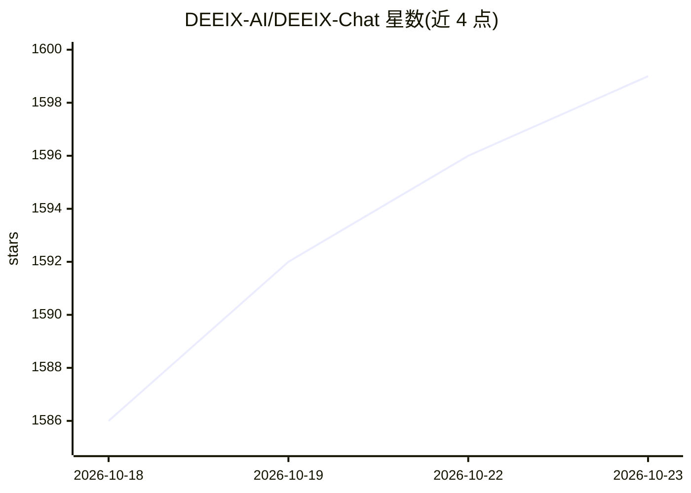

# DEEIX-AI/DEEIX-Chat

⭐ 1,599 · Go · Apache-2.0 · 推送 2026-10-22 · [GitHub](https://github.com/DEEIX-AI/DEEIX-Chat) · [官网](https://deeix.com) · 组织维护 · 中文 README

**面向个人/团队/企业的自托管多模型 AI 聊天与网关平台**

开源可部署的一体化 AI 平台：统一接入 OpenAI、Anthropic、Google/Gemini、xAI、OpenRouter 及 OpenAI 兼容协议，提供多模态对话、模型路由（优先级/权重/熔断）、文件上传与 RAG 检索、MCP 工具、按次计费与订阅（Stripe/EPay）、SSO/2FA 身份、审计日志等。前后端分离开发（Next.js/React + Go），单运行时部署；文档抽取与 OCR 为可选服务。支持 SQLite 轻量部署或 PostgreSQL/Redis 全栈 Compose，并提供 macOS/Linux/Windows 桌面构建流程。

## 筛选速览

| 维度 | 判定 | 备注 |
|---|---|---|
| AI 角色 | `ai-native` | 本体是模型或模型工具 |
| 许可风险 | `permissive` | Apache-2.0 |
| 部署形态 | `self-host` | docker 或自建部署 |
| 模型依赖 | locked-api |  |
| 硬件要求 | — | 无带数字的原话,不猜 |
| 安装摩擦 | `low` | 无编译、无系统依赖或容器化 |
| 成熟度 | — | 结构信号不足 |

## 能力要点

- 统一协议适配：OpenAI、Anthropic、Gemini、xAI、OpenRouter 及 OpenAI 兼容协议
- 模型路由层：路由绑定、优先级、权重、熔断、厂商映射
- 文件与 RAG：上传、抽取、OCR、分块、嵌入与语义检索进入对话上下文
- MCP 工具集成与计费/身份/审计的企业运营能力

## 适用场景

- 团队或企业自托管统一入口访问多家模型供应商
- 在对话中直接检索自有文件资料（RAG）
- 为组织内部按用量计费、管理与审计模型使用
- 低依赖场景用 SQLite 单容器部署做评估或个人使用

## 场景标签

`模型网关` `RAG` `聊天机器人` · 领域:Agent 开发

## 证据(README 行号)

> L18: DEEIX Chat is an open-source, deployable AI platform for individuals, teams, and enterprises that need long-term, s
> L28: |Conversations|A multimodal chat interface for daily use, with streaming, branches, retries, edits, feedback, shari

## 星数曲线

2026-10-18 1,586 → 2026-10-23 1,599（+13）

---
*卡片 v1 · prompt 1.4 · 生成 2026-10-21 · 置信度 mid · 依据 README sha `2a671b3cdee7` · [字段定义](../../DATASET.md)*
