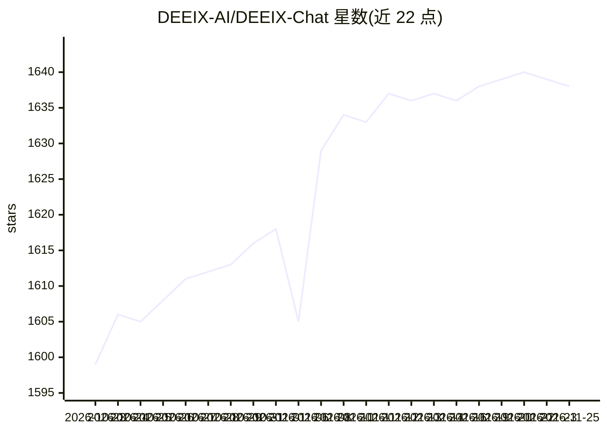

# DEEIX-AI/DEEIX-Chat

⭐ 1,638 · Go · Apache-2.0 · 推送 2026-11-17 · [GitHub](https://github.com/DEEIX-AI/DEEIX-Chat) · [官网](https://deeix.com) · 组织维护

**企业 AI 工作台：多模型接入、路由、RAG、计费与运维一体**

开源可自部署的 AI 平台，为个人、团队和企业提供对多个上游模型供应商的统一入口。功能覆盖多模态对话（流式、分支、分享）、平台级模型路由（通道绑定、优先级、熔断）、文件上传与 RAG 语义检索、MCP 工具生态、用量计费（Stripe/EPay）、身份认证（SSO/OIDC/2FA）与审计日志。前端 Next.js、后端 Go 单运行时部署，支持 SQLite 轻量配置或 PostgreSQL/Redis 生产栈，提供 Docker Compose 三种部署档位与桌面版构建流水线。

## 筛选速览

| 维度 | 判定 | 备注 |
|---|---|---|
| AI 角色 | `ai-ecosystem` | LLM/agent 周边工具 |
| 许可风险 | `permissive` | Apache-2.0 |
| 部署形态 | `self-host` | docker 或自建部署 |
| 模型依赖 | locked-api |  |
| 硬件要求 | — | 无带数字的原话,不猜 |
| 安装摩擦 | `low` | 无编译、无系统依赖或容器化 |
| 成熟度 | — | 结构信号不足 |

## 能力要点

- 统一接入 OpenAI、Anthropic、Gemini、xAI、OpenRouter 及 OpenAI 兼容协议
- 平台模型路由层：通道绑定、优先级、权重、熔断与厂商映射
- 文件上传、OCR 抽取、分块嵌入与语义检索进入对话上下文
- 内置计费、订阅、余额与用量台账，含 Stripe/EPay 支付

## 适用场景

- 企业自托管统一网关，聚合多家模型供应商并做路由管理
- 团队内部署带文件 RAG 与 MCP 工具的对话工作台
- 对外提供模型服务并按用量计费的场景

## 场景标签

`模型网关` `RAG` `聊天机器人` · 领域:Agent 开发

## 证据(README 行号)

> L18: DEEIX Chat is an open-source, deployable AI platform for individuals, teams, and enterprises that need long-term, s
> L29: |Models and routing|A platform-model layer for upstream channels, real models, route bindings, priority, weights, c
> L65: |Deployment runtime|Lightweight single-node deployment or multi-node production deployment|Docker, Docker Compose, 

## 星数曲线

2026-10-23 1,599 → 2026-11-25 1,638（+39）

---
*卡片 v1 · prompt 1.4 · 生成 2026-11-23 · 置信度 high · 依据 README sha `9f85231a2cdb` · [字段定义](../../DATASET.md)*
