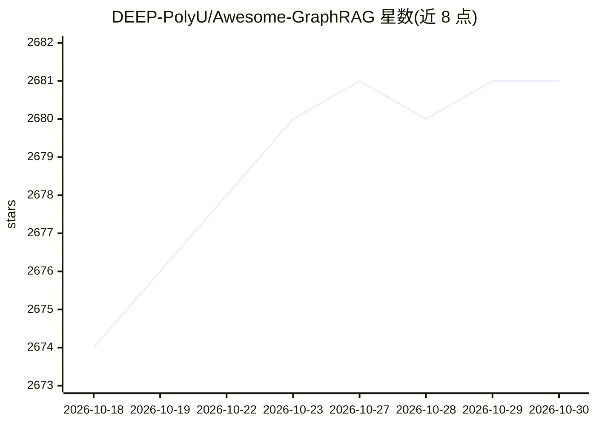

# DEEP-PolyU/Awesome-GraphRAG

⭐ 2,681 · MIT · 推送 2026-06-02 · [GitHub](https://github.com/DEEP-PolyU/Awesome-GraphRAG) · [官网](https://arxiv.org/abs/2501.13958) · 组织维护

**GraphRAG 研究资源策展清单：论文、基准与开源项目分类收录**

配合综述论文《A Survey of Graph Retrieval-Augmented Generation for Customized Large Language Models》(arXiv:2506.08938)维护的资源清单，收录 GraphRAG 相关论文、综述、基准与开源项目，按知识组织（知识索引/知识载体/已有知识图谱）、检索、评测等类别组织条目。每条含会议/年份与论文链接，由多位共同第一作者维护并持续更新，欢迎研究者投稿补充。仓库同时发布团队自身的 GraphRAG Benchmark 数据集与 LinearRAG、LogicRAG 等成果动态。

## 筛选速览

| 维度 | 判定 | 备注 |
|---|---|---|
| AI 角色 | `ai-knowledge` | 知识聚合/清单类 |
| 许可风险 | `permissive` | MIT |
| 部署形态 | `None` |  |
| 模型依赖 | — | README 未给出锁定关系 |
| 硬件要求 | — | 无带数字的原话,不猜 |
| 安装摩擦 | `low` | 无编译、无系统依赖或容器化 |
| 成熟度 | — | 结构信号不足 |

## 能力要点

- 按综述框架对 GraphRAG 论文分类组织（知识索引/知识载体/已有 KG 等）
- 配套 arXiv:2506.08938 综述论文，持续更新
- 发布 GraphRAG Benchmark 数据集与评测基准
- 条目均附论文链接与发表会议信息

## 适用场景

- 查找 GraphRAG 领域的代表性论文与开源项目
- 按知识组织/检索等主题梳理 GraphRAG 研究脉络
- 寻找 GraphRAG 评测基准数据集

## 场景标签

`精选清单` `知识图谱` · 领域:知识与检索

## 证据(README 行号)

> L3:  arXiv:2506.08938
> L5: This repository contains a curated list of resources on graph-based retrieval-augmented generation (GraphRAG), which

## 星数曲线

2026-10-18 2,674 → 2026-10-30 2,681（+7）

---
*卡片 v1 · prompt 1.4 · 生成 2026-10-21 · 置信度 high · 依据 README sha `c3b5c258e705` · [字段定义](../../DATASET.md)*
