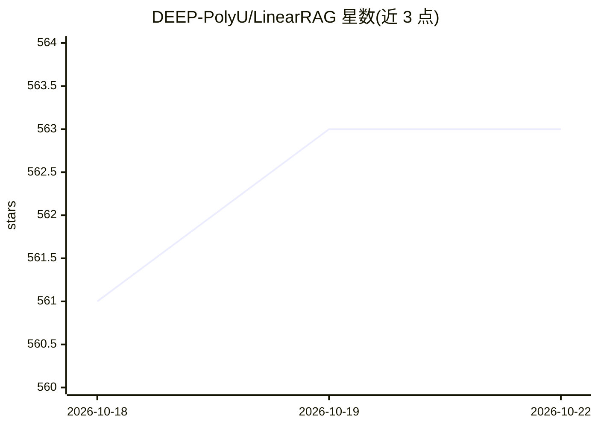

# DEEP-PolyU/LinearRAG

⭐ 563 · Python · GPL-3.0 · 推送 2026-07-05 · [GitHub](https://github.com/DEEP-PolyU/LinearRAG) · [官网](https://arxiv.org/pdf/2510.10114) · 组织维护

**免 LLM 建图的高效 GraphRAG 方法（ICLR 2026 论文代码）**

研究团队发布的 LinearRAG 方法实现：以无关系（relation-free）图构建替代依赖 LLM 抽取关系的传统 GraphRAG 建图，通过轻量实体识别（Spacy）与语义链接构建图，图构建阶段零 LLM token 消耗，时间/空间复杂度为线性；检索阶段经语义桥接在单次检索中完成多跳推理，生成阶段调用 OpenAI API。提供 pip 依赖安装、Spacy 模型下载、HuggingFace 数据集（2wikimultihop、medical 等）与 all-mpnet-base-v2 嵌入模型的完整流程，附性能对比实验。

## 筛选速览

| 维度 | 判定 | 备注 |
|---|---|---|
| AI 角色 | `ai-native` | 本体是模型或模型工具 |
| 许可风险 | `viral` | GPL-3.0 |
| 部署形态 | `library` | 以包/库形式分发 |
| 模型依赖 | — | README 未给出锁定关系 |
| 硬件要求 | — | 无带数字的原话,不猜 |
| 安装摩擦 | `low` | 无编译、无系统依赖或容器化 |
| 成熟度 | — | 结构信号不足 |

## 能力要点

- 无关系图构建，图构建阶段零 LLM token 消耗
- 线性时间/空间复杂度，面向大规模语料
- 轻量实体识别（Spacy）与语义链接替代 LLM 建图
- 单次检索完成多跳推理

## 适用场景

- 在大规模语料上以低成本构建 GraphRAG 图索引
- 研究多跳问答与 GraphRAG 效率对比
- 复现 ICLR 2026 论文实验结果

## 场景标签

`RAG` `知识图谱` · 领域:知识与检索

## 证据(README 行号)

> L3: > A relation-free graph construction method for efficient GraphRAG. It eliminates LLM token costs during graph const
> L30: - ✅ **Context-Preserving**: Relation-free graph construction, relying on lightweight entity recognition and semanti
> L32: - ✅ **High Scalability**: Zero LLM token consumption, faster processing speed, and linear time/space complexity.

## 星数曲线

2026-10-18 561 → 2026-10-22 563（+2）

---
*卡片 v1 · prompt 1.4 · 生成 2026-10-21 · 置信度 high · 依据 README sha `97e711d298b6` · [字段定义](../../DATASET.md)*
