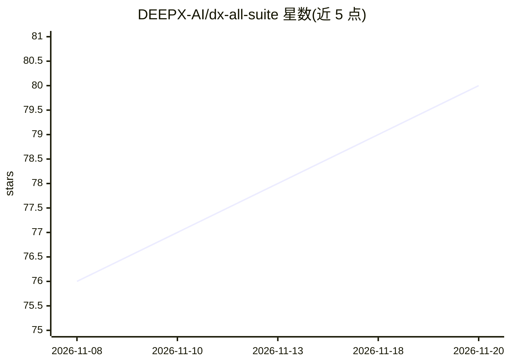

# DEEPX-AI/dx-all-suite

⭐ 80 · Python · NOASSERTION · 推送 2026-11-19 · [GitHub](https://github.com/DEEPX-AI/dx-all-suite) · [官网](https://developer.deepx.ai/) · 组织维护

**DEEPX NPU 官方 SDK：编译、量化并在 DEEPX NPU 上部署 ONNX 模型**

面向 DEEPX NPU（如 DX-M1）的全流程 SDK：DX-COM 编译器将 ONNX 模型编译、INT8 量化并生成 .dxnn 二进制，DX-STREAM 提供基于 GStreamer 的视频分析管线插件，ModelZoo 收录 300+ 优化模型，并提供 Python/C++ API。支持本机安装、APT 仓库、Docker 镜像与 Kubernetes（Helm chart + 设备插件）调度 NPU。编译环境需 x86_64 Linux 主机，运行环境需实际配备 DEEPX NPU 的设备并安装驱动后重启。另含 Beta 阶段的 Agent 驱动开发工具与浏览器工作台。

## 筛选速览

| 维度 | 判定 | 备注 |
|---|---|---|
| AI 角色 | `ai-ecosystem` | LLM/agent 周边工具 |
| 许可风险 | `none` | NOASSERTION |
| 部署形态 | `self-host` | docker 或自建部署 |
| 模型依赖 | — | README 未给出锁定关系 |
| 硬件要求 | — | 无带数字的原话,不猜 |
| 安装摩擦 | `low` | 无编译、无系统依赖或容器化 |
| 成熟度 | `idea` | |

## 能力要点

- DX-COM 编译器：ONNX 编译、INT8 智能量化、生成 .dxnn 二进制
- DX-STREAM 基于 GStreamer 的视频分析管线插件
- ModelZoo 提供 300+ 优化模型，支持 Python/C++ API
- 支持 Docker 镜像与 Kubernetes（dx-npu Helm chart、设备插件、CDI）调度

## 适用场景

- 把训练好的 ONNX 模型编译量化后部署到 DEEPX NPU 边缘设备
- 在 DX-M1 上搭建实时视频分析（检测/OCR）管线
- 在 Kubernetes 集群中以资源方式调度多节点 NPU

## 场景标签

`模型量化` `推理引擎` · 领域:训练与推理

## 证据(README 行号)

> L3: **DX-AllSuite** is an all-in-one software platform designed to streamline the entire process of compiling, optimizin
> L9: - **High Efficiency**: Equipped with the proprietary **DX-COM** compiler that extracts 100% of NPU performance. It u
> L50: - **Key Tasks**: AI model (`.onnx`) compilation, Quantization, `.dxnn` generation

## 星数曲线

2026-11-08 76 → 2026-11-20 80（+4）

---
*卡片 v1 · prompt 1.4 · 生成 2026-11-18 · 置信度 high · 依据 README sha `1301b04999e0` · [字段定义](../../DATASET.md)*
