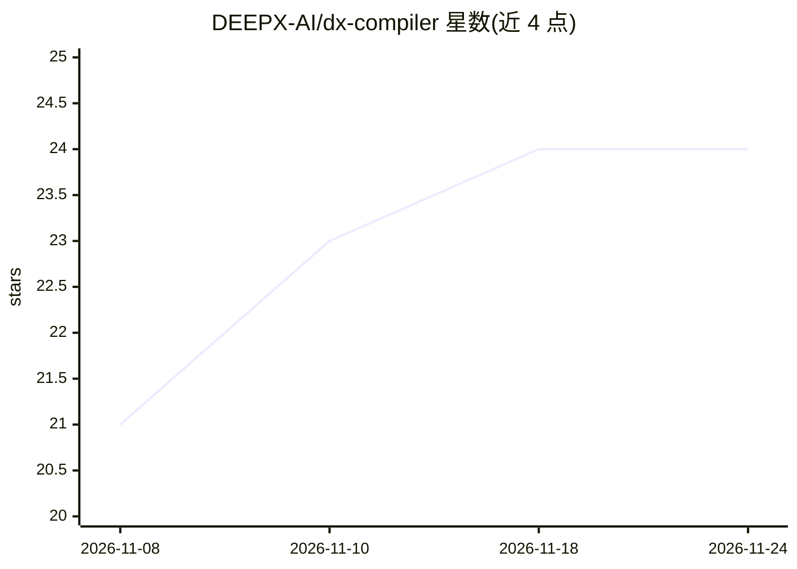

# DEEPX-AI/dx-compiler

⭐ 24 · Shell · NOASSERTION · 推送 2026-11-23 · [GitHub](https://github.com/DEEPX-AI/dx-compiler) · [官网](https://developer.deepx.ai/tech-docs/) · 组织维护

**DEEPX NPU 编译器：将 ONNX 模型转为 DX-M1 等 NPU 的 .dxnn 二进制**

DEEPX DXNN SDK 的编译器组件（DX-COM），运行在 x86_64 Linux 主机上，将 ONNX 模型转换为面向 DEEPX NPU（如 DX-M1）优化的 .dxnn 二进制，支持 INT8 量化。安装方式包括 curl 一键脚本（自动创建 venv 并安装 PyPI 上的 dx-com 包与 dxcom 命令）、仓库本地 install.sh 与 Docker 镜像两条路径；依赖含 torch 与 onnxruntime，首次安装下载量达数 GB。操作系统覆盖 Ubuntu 20.04–26.04、Fedora 42-45、RHEL 9-10 与 CentOS Stream 9-10。

## 筛选速览

| 维度 | 判定 | 备注 |
|---|---|---|
| AI 角色 | `ai-ecosystem` | LLM/agent 周边工具 |
| 许可风险 | `none` | NOASSERTION |
| 部署形态 | `library` | 以包/库形式分发 |
| 模型依赖 | — | README 未给出锁定关系 |
| 硬件要求 | — | 无带数字的原话,不猜 |
| 安装摩擦 | `medium` | 含编译或系统依赖之一 |
| 成熟度 | — | 结构信号不足 |

## 能力要点

- 将 ONNX 模型转换为 DEEPX NPU 专用的 .dxnn 优化二进制（含 INT8 量化）
- curl 一键安装脚本：自动建 venv、链接 dxcom 命令到 PATH，支持版本与路径环境变量
- 支持 x86_64 架构与 Debian/Fedora/RHEL/CentOS 系发行版
- 提供本地安装与 Docker 镜像两种部署路径

## 适用场景

- 在 x86_64 主机上把 ONNX 模型编译为 DEEPX NPU 可执行的 .dxnn 二进制
- 作为 DXNN SDK（DX-AS）工具链的一部分搭建 NPU 开发环境
- 团队共享机器上以系统路径做系统级安装

## 场景标签

`推理引擎` `模型量化` · 领域:训练与推理

## 证据(README 行号)

> L14:  - Must be installed on the Host machine that will perform the compilation (converting) of ONNX models to our propr
> L17:  - DX-COM: Converts ONNX models into highly optimized, NPU-ready binaries.

## 星数曲线

2026-11-08 21 → 2026-11-24 24（+3）

---
*卡片 v1 · prompt 1.4 · 生成 2026-11-18 · 置信度 high · 依据 README sha `434f405dcf44` · [字段定义](../../DATASET.md)*
