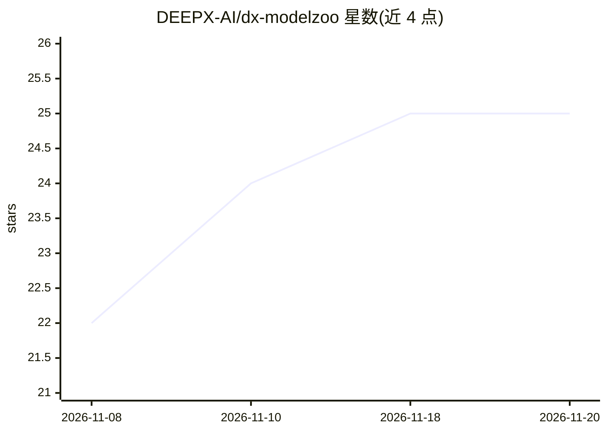

# DEEPX-AI/dx-modelzoo

⭐ 25 · Python · MIT · 推送 2026-11-19 · [GitHub](https://github.com/DEEPX-AI/dx-modelzoo) · [官网](https://developer.deepx.ai/modelzoo/) · 组织维护

**面向 DEEPX NPU 的模型管理、评测与编译框架**

以单个 YAML 配置驱动模型预处理、后处理、评测与 NPU 编译全流程的统一框架，无需编写 Python 代码。内置 300+ 生产级 CV 模型（分类/检测/分割等），支持 ONNX Runtime 与 NPU/dxnn 多运行时 profile（onnx/c-lite/q-lite/q-pro），通过注册机制可扩展自定义组件与算子，并提供 dxmz 命令行工具浏览、查看、评测与编译模型。需先安装 DeepX Runtime 与 DX-Compiler，Python 3.8+。

## 筛选速览

| 维度 | 判定 | 备注 |
|---|---|---|
| AI 角色 | `ai-ecosystem` | LLM/agent 周边工具 |
| 许可风险 | `permissive` | MIT |
| 部署形态 | `library` | 以包/库形式分发 |
| 模型依赖 | — | README 未给出锁定关系 |
| 硬件要求 | — | 无带数字的原话,不猜 |
| 安装摩擦 | `low` | 无编译、无系统依赖或容器化 |
| 成熟度 | — | 结构信号不足 |

## 能力要点

- 单 YAML 文件定义完整模型流水线，无需 Python 代码
- 300+ 内置 CV 模型，覆盖分类/检测/分割
- 支持 ONNX Runtime 与 NPU/dxnn 多运行时 profile
- @REGISTRY 注册机制与 custom_ops.py 自动发现扩展

## 适用场景

- 为 DEEPX NPU 编译并部署 CV 模型
- 在同一配置下对比 ONNX 与 NPU 运行时的模型表现
- 批量管理评测数据集与模型流水线

## 场景标签

`模型评测` `推理引擎` · 领域:评测与运维

## 证据(README 行号)

> L5: DX-ModelZoo is a unified framework for managing model preprocessing, postprocessing, evaluation, and NPU compilation
> L12: - **Multi-Profile Execution** — Manage ONNX, NPU/dxnn, and other runtime profiles within one YAML.
> L78: dxmz compile resnet50_224x224 --profile q-lite

## 星数曲线

2026-11-08 22 → 2026-11-20 25（+3）

---
*卡片 v1 · prompt 1.4 · 生成 2026-11-18 · 置信度 high · 依据 README sha `8426e93a6e75` · [字段定义](../../DATASET.md)*
