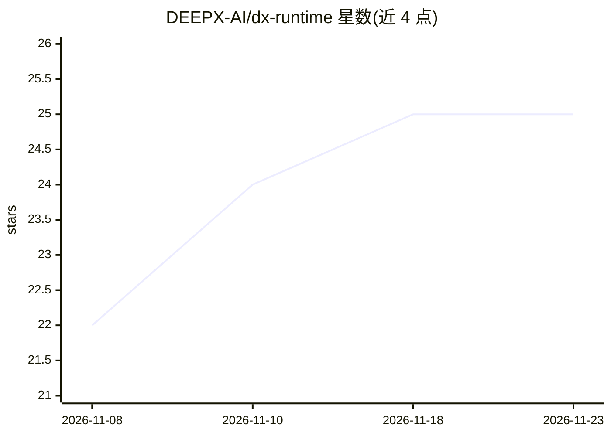

# DEEPX-AI/dx-runtime

⭐ 25 · Shell · NOASSERTION · 推送 2026-11-20 · [GitHub](https://github.com/DEEPX-AI/dx-runtime) · [官网](https://developer.deepx.ai/tech-docs/) · 组织维护

**DEEPX NPU 运行时与 Linux 驱动：在 DX-M1 加速器上运行 .dxnn 模型**

DEEPX 官方发布的边缘 AI 推理软件栈仓库：以 Git 子模块形式管理 NPU Linux 驱动、固件（dx_fw）、运行时（dx_rt）、C++/Python 示例（dx_app）与 GStreamer 插件（dx_stream），用于在插有 DX-M1 M.2 NPU 模块的目标系统上编译与运行 .dxnn 模型。支持 Debian 系 Linux（Ubuntu 20.04-26.04、Debian 12/13）与 x86_64/arm64 架构，提供本地源码、APT 仓库、Docker 及一行脚本四种安装方式；固件不随 APT 包分发，需单独更新，安装后需重启一次。

## 筛选速览

| 维度 | 判定 | 备注 |
|---|---|---|
| AI 角色 | `ai-ecosystem` | LLM/agent 周边工具 |
| 许可风险 | `none` | NOASSERTION |
| 部署形态 | `library` | 以包/库形式分发 |
| 模型依赖 | — | README 未给出锁定关系 |
| 硬件要求 | — | 无带数字的原话,不猜 |
| 安装摩擦 | `low` | 无编译、无系统依赖或容器化 |
| 成熟度 | — | 结构信号不足 |

## 能力要点

- 五个子模块：NPU 驱动、固件、DX-RT 运行时、DX-APP 示例、DX-Stream GStreamer 插件
- 支持 x86_64 与 arm64 架构，Ubuntu/Debian 系统
- 提供 APT 仓库、Docker、一行脚本等多种安装途径，可按组件锁定版本
- APT 路线提供签名密钥指纹校验（3A20CC…DBDEA）

## 适用场景

- 为插有 DX-M1 M.2 模块的边缘设备搭建 NPU 推理环境
- 用 C++/Python 示例或 GStreamer 管线集成 .dxnn 模型推理
- 在 Ubuntu/Debian 服务器上通过 apt 安装并升级驱动与运行时

## 场景标签

`推理引擎` · 领域:训练与推理

## 证据(README 行号)

> L14:  - Must be installed on the Target system where the DEEPX M1 M.2 module is attached and the DEEPX AI model (.dxnn) 
> L17:  - DX-RT & DX-FW & NPU Driver: Foundational software for NPU control
> L19:  - DX-Stream: GStreamer integration for seamless multimedia pipelines

## 星数曲线

2026-11-08 22 → 2026-11-23 25（+3）

---
*卡片 v1 · prompt 1.4 · 生成 2026-11-18 · 置信度 mid · 依据 README sha `d341e1bb5483` · [字段定义](../../DATASET.md)*
