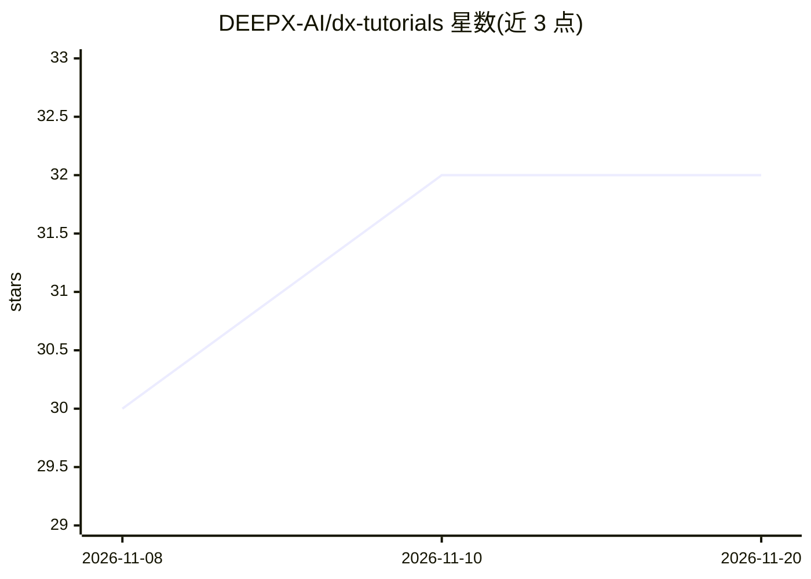

# DEEPX-AI/dx-tutorials

⭐ 32 · Jupyter Notebook · NOASSERTION · 推送 2026-11-09 · [GitHub](https://github.com/DEEPX-AI/dx-tutorials) · [官网](https://developer.deepx.ai/) · 组织维护

**DEEPX NPU 上的 SDK 上手教程集：装 SDK、编译 ONNX、跑推理与边缘 AI 应用**

面向 DEEPX NPU 硬件的 JupyterLab 实操教程仓库：从克隆 DX-All Suite、安装 DX-COM/DX-Runtime、验证 NPU 开始，到用编译器把 ONNX 转 DXNN（含校准、量化、图优化），再到用 DX-Runtime 的 CLI 与 Python/C++ API 构建完整应用。附带 PP-OCR、YOLO 多路视频、CLIP、手部关键点等示例工程。教程覆盖安装步骤、路径解析约定与多语言（英韩日中）翻译机制。需要 DEEPX NPU 硬件，SDK 安装调用 sudo apt-get；DX-COM 编译器仅运行于 x86_64。

## 筛选速览

| 维度 | 判定 | 备注 |
|---|---|---|
| AI 角色 | `ai-knowledge` | 知识聚合/清单类 |
| 许可风险 | `none` | NOASSERTION |
| 部署形态 | `library` | 以包/库形式分发 |
| 模型依赖 | — | README 未给出锁定关系 |
| 硬件要求 | — | 无带数字的原话,不猜 |
| 安装摩擦 | `high` | 编译与系统依赖俱全 |
| 成熟度 | — | 结构信号不足 |

## 能力要点

- 从 SDK 安装、ONNX→DXNN 编译到 Python/C++ 应用部署的完整教程链（T00-T24）
- 包含 PP-OCRv6、YOLO 36 路视频、CLIP、手部关键点等示例工程
- 笔记本提供英/韩/日/中四语版本，共享代码单元
- 硬件相关单元以标志位守护，避免 Run All 意外阻塞或改动系统

## 适用场景

- 在 DEEPX NPU 上从零学习 SDK 安装与模型编译部署
- 训练并部署自定义 YOLO 检测模型的端到端实践
- 参考多路视频推理、OCR、CLIP 等 C++ 示例工程

## 场景标签

`教程课程` · 领域:学习与行业

## 证据(README 行号)

> L6: **Welcome!** This repository is a collection of hands-on JupyterLab tutorials for the DEEPX SDK (DX-All Suite). It s
> L12: |Tutorial|What you learn|Needs an NPU|Other requirements|

## 星数曲线

2026-11-08 30 → 2026-11-20 32（+2）

---
*卡片 v1 · prompt 1.4 · 生成 2026-11-18 · 置信度 mid · 依据 README sha `c2923ae13b17` · [字段定义](../../DATASET.md)*
