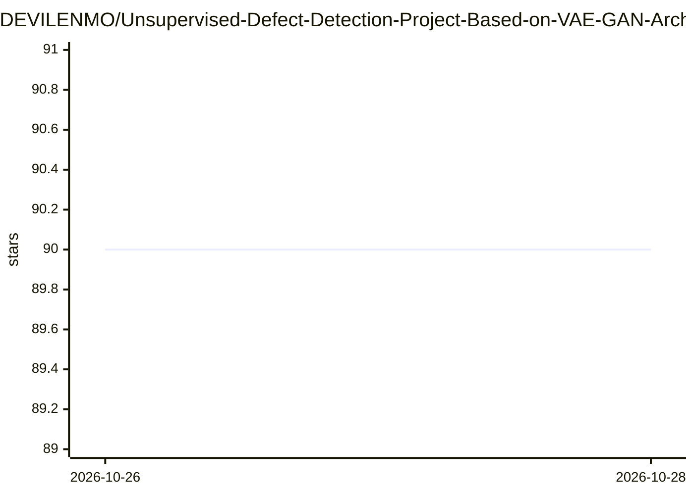

# DEVILENMO/Unsupervised-Defect-Detection-Project-Based-on-VAE-GAN-Architecture

⭐ 90 · Python · GPL-3.0 · 推送 2026-10-26 · [GitHub](https://github.com/DEVILENMO/Unsupervised-Defect-Detection-Project-Based-on-VAE-GAN-Architecture) · 个人维护 · 中文 README

**无需标注数据的图像缺陷检测工具：VAE-CycleGAN 重建比对**

基于 VAE 与 CycleGAN 结合的图像重建式无监督缺陷检测项目：模型只用正常样本训练，推理时将待检图重建并与原图比对，输出缺陷掩码、四联对比图与 SSIM 分数（越低异常越严重）。流程包含 SAM 自动切割目标、人工筛选正常样本、训练 VAE-GAN、推理检测四步，另提供 MAML 元学习冷启动选项。环境为 Python 3.10+ 与 PyTorch 2.x，建议 NVIDIA GPU（CPU 可跑但慢），需自行下载约 1.2 GB 的 SAM ViT-L 权重。

## 筛选速览

| 维度 | 判定 | 备注 |
|---|---|---|
| AI 角色 | `ai-native` | 本体是模型或模型工具 |
| 许可风险 | `viral` | GPL-3.0 |
| 部署形态 | `library` | 以包/库形式分发 |
| 模型依赖 | — | README 未给出锁定关系 |
| 硬件要求 | — | 无带数字的原话,不猜 |
| 安装摩擦 | `medium` | 含编译或系统依赖之一 |
| 成熟度 | — | 结构信号不足 |

## 能力要点

- 仅需正常样本训练，无需标注缺陷数据
- SAM 自动切割目标 + VAE 重建 + PatchGAN 判别器局部反馈
- 输出缺陷掩码、原图/重建/差异四联图与 SSIM 异常评分
- 支持 MAML 元学习冷启动与训练自动续训

## 适用场景

- 工业品照片（如 PCB）在没有缺陷标注时做缺陷检测
- 批量对待检图片生成缺陷掩码与异常评分
- 正常样本有限时用元学习冷启动改善训练起点

## 场景标签

`目标检测` · 领域:感知与多模态

## 证据(README 行号)

> L3: This project implements an unsupervised defect detection algorithm based on VAE-CycleGAN for image reconstruction. T
> L11: - Unsupervised learning: No need for labeled anomaly data
> L143: A lower SSIM score (printed to console and shown in the figure title) means more severe anomalies.

## 星数曲线

2026-10-26 90 → 2026-10-28 90（+0）

---
*卡片 v1 · prompt 1.4 · 生成 2026-10-27 · 置信度 high · 依据 README sha `4d60002d7881` · [字段定义](../../DATASET.md)*
