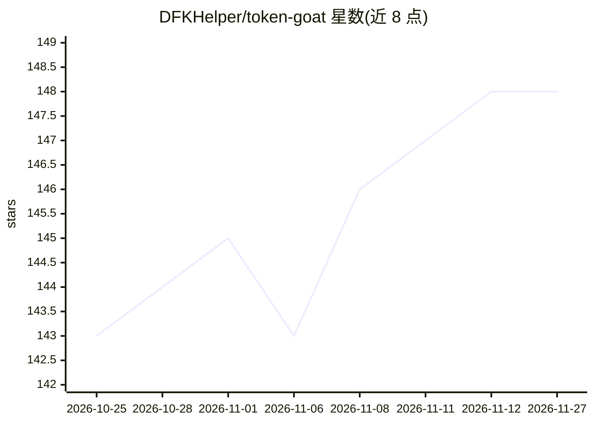

# DFKHelper/token-goat

⭐ 148 · TypeScript · NOASSERTION · 推送 2026-11-25 · [GitHub](https://github.com/DFKHelper/token-goat) · [官网](https://www.npmjs.com/package/token-goat) · 个人维护

**面向 AI 编码代理的 token 与成本削减拦截工具**

以 hooks/MCP 方式介于 AI 编码代理与工具输出之间：拦截重复文件读取并给出提示或窄切片、压缩截图、剥离构建日志噪音、在 PDF/Office/CSV/Markdown 读取时只注入标题树或列预览、压缩前后注入会话清单以保留记忆、缓存与压缩技能体、并以不可信内容围栏防 prompt injection。支持 Claude Code、Codex CLI、Gemini CLI、Aider、Cursor 等 17 种客户端。npm 一条命令安装，需 Node.js，支持 Windows 10/11 与 Linux/WSL，macOS 标注未测试。

## 筛选速览

| 维度 | 判定 | 备注 |
|---|---|---|
| AI 角色 | `ai-ecosystem` | LLM/agent 周边工具 |
| 许可风险 | `none` | NOASSERTION |
| 部署形态 | `desktop` | 安装包/桌面程序 |
| 模型依赖 | — | README 未给出锁定关系 |
| 硬件要求 | — | 无带数字的原话,不猜 |
| 安装摩擦 | `low` | 无编译、无系统依赖或容器化 |
| 成熟度 | — | 结构信号不足 |

## 能力要点

- 255+ 过滤与拦截规则，重复读取/命令输出/技能加载拦截
- 图像压缩（README 称截图可缩小 97.4%）与外科式符号级读取
- compact 前注入结构化会话清单，缓存已加载技能（约 400 token 紧凑形式）
- 对所有抓取页面与工具结果加不可信内容围栏防 prompt injection

## 适用场景

- 减少 Claude Code/Codex 等代理会话的 token 与费用
- 长会话压缩后保留已编辑文件与关键符号的记忆
- 防止代理反复读取同一文件浪费轮次
- 在代理工作流中拦截不可信内容防 prompt injection

## 场景标签

`编码 Agent` · 领域:编码与开发

## 证据(README 行号)

> L20: Token-Goat sits silently between your AI and your tools. Re-read a file? It gets a one-line hint and a narrow-slice
> L33: Works with **Claude Code**, **Gemini CLI**, **Qwen Code**, **Codex CLI**, **Aider**, **Cursor**, **Cline**, **Winds
> L35: **Ask your AI to install it fully (give it this GitHub link), or install in one command:**

## 星数曲线

2026-10-25 143 → 2026-11-27 148（+5）

---
*卡片 v1 · prompt 1.4 · 生成 2026-11-27 · 置信度 mid · 依据 README sha `c743d9a7dd6a` · [字段定义](../../DATASET.md)*
