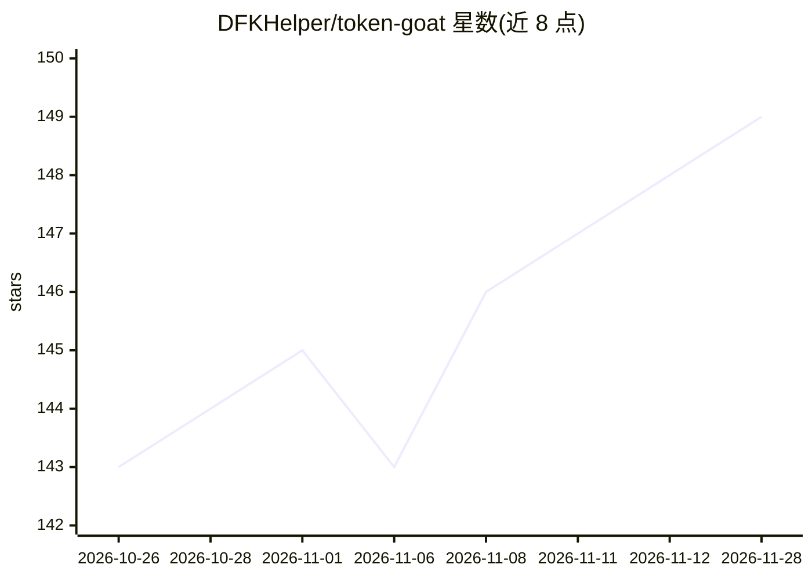

# DFKHelper/token-goat

⭐ 149 · TypeScript · NOASSERTION · 推送 2026-11-27 · [GitHub](https://github.com/DFKHelper/token-goat) · [官网](https://www.npmjs.com/package/token-goat) · 个人维护

**为 AI 编程工具削减 token 成本与上下文占用的 CLI 优化层**

以 hook 形式插入 AI 编程代理与工具之间的 CLI 层：拦截重复文件读取并改为单行提示或窄切片、压缩截图、将 pytest/npm 等命令输出裁剪到失败项、在 PDF/CSV/大文档被读取前只交付标题树或列预览、压缩前注入会话清单、拦截重复 skill 加载并提供缓存紧凑版，同时把抓取的页面与工具结果包进不可信内容围栏以防御 prompt injection。支持 Claude Code、Gemini CLI、Codex CLI 等多个代理，npm 全局安装，需 Node.js。

## 筛选速览

| 维度 | 判定 | 备注 |
|---|---|---|
| AI 角色 | `ai-ecosystem` | LLM/agent 周边工具 |
| 许可风险 | `none` | NOASSERTION |
| 部署形态 | `desktop` | 安装包/桌面程序 |
| 模型依赖 | — | README 未给出锁定关系 |
| 硬件要求 | — | 无带数字的原话,不猜 |
| 安装摩擦 | `low` | 无编译、无系统依赖或容器化 |
| 成熟度 | — | 结构信号不足 |

## 能力要点

- 255+ 过滤与拦截规则，覆盖重复读取、截图压缩、命令输出裁剪
- PDF/Office/CSV/Markdown 文件拦截，仅注入标题树、页数或列预览
- 压缩前注入结构化会话清单，skill 缓存紧凑版（约 400 token）
- 不可信内容围栏扫描以防御 prompt injection，可一行配置关闭

## 适用场景

- 长会话中反复读取同一批大文件导致成本累积时
- 让 AI 代理读取 PDF/CSV 时只取结构摘要而非全文
- 压缩 /compact 后恢复被遗忘的已编辑文件与已加载 skill

## 场景标签

 · 领域:开发者工具/AI 编程辅助

## 证据(README 行号)

> L20: Token-Goat sits silently between your AI and your tools. Re-read a file? It gets a one-line hint and a narrow-slice
> L33: Works with **Claude Code**, **Gemini CLI**, **Qwen Code**, **Codex CLI**, **Aider**, **Cursor**, **Cline**, **Winds
> L38: npm install -g token-goat && token-goat install

## 星数曲线

2026-10-26 143 → 2026-11-28 149（+6）

---
*卡片 v1 · prompt 1.4 · 生成 2026-11-28 · 置信度 mid · 依据 README sha `06fd4d9ab1fa` · [字段定义](../../DATASET.md)*
