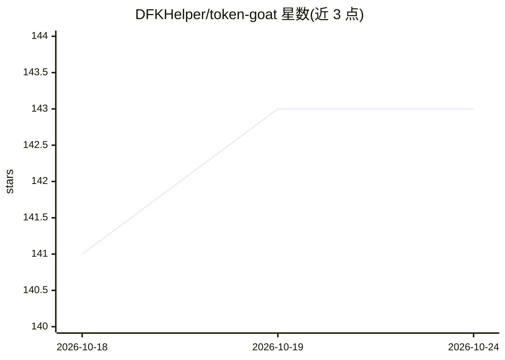

# DFKHelper/token-goat

⭐ 143 · TypeScript · NOASSERTION · 推送 2026-10-24 · [GitHub](https://github.com/DFKHelper/token-goat) · [官网](https://www.npmjs.com/package/token-goat) · 个人维护

**AI 编码工具的 token 消耗拦截器：削减重复读取与注入防御**

以 hooks 形式嵌入 AI 编码助手与工具调用之间的中间层：拦截重复文件读取并改为指针/窄切片提示、压缩截图、剥离构建与测试日志中的冗余行、拦截 PDF/Office/CSV/Markdown 大文件读取并给出结构摘要、缓存重复的 skill 注入与 MCP 调用，并在压缩前注入结构化会话清单以保留关键上下文。另对抓取网页与工具结果包裹不可信内容围栏以防御提示注入。以 npm 全局包安装，配合 Claude Code、Codex CLI、Gemini CLI、Copilot 等 15+ 客户端使用。

## 筛选速览

| 维度 | 判定 | 备注 |
|---|---|---|
| AI 角色 | `ai-ecosystem` | LLM/agent 周边工具 |
| 许可风险 | `none` | NOASSERTION |
| 部署形态 | `desktop` | 安装包/桌面程序 |
| 模型依赖 | — | README 未给出锁定关系 |
| 硬件要求 | — | 无带数字的原话,不猜 |
| 安装摩擦 | `low` | 无编译、无系统依赖或容器化 |
| 成熟度 | — | 结构信号不足 |

## 能力要点

- 205+ 过滤与拦截规则，覆盖读取、Bash、skill、WebFetch 等路径
- 重复读取替换为指针/窄切片，含 shell 命令（cat/head/sed）级文本匹配去重
- PDF/Office/CSV/Markdown 拦截为标题树/页数/列预览
- 所有外部内容包裹不可信围栏的提示注入防御

## 适用场景

- 降低长会话与多轮任务中的 AI 编码助手 token 开销
- 防止 compaction 丢失已编辑文件与 skill 上下文
- 剥离构建/测试日志冗余输出，只保留失败信息
- 为 AI 编码工作流加一层提示注入防护

## 场景标签

 · 领域:开发者工具/AI 编码助手

## 证据(README 行号)

> L20: Token-Goat sits silently between your AI and your tools. Re-read a file? It gets a one-line hint and a narrow-slice
> L24: Works with **Claude Code**, **Gemini CLI**, **Qwen Code**, **Codex CLI**, **Aider**, **Cursor**, **Cline**, **Winds
> L29: npm install -g token-goat && token-goat install

## 星数曲线

2026-10-18 141 → 2026-10-24 143（+2）

---
*卡片 v1 · prompt 1.4 · 生成 2026-10-23 · 置信度 mid · 依据 README sha `8de659b52126` · [字段定义](../../DATASET.md)*
