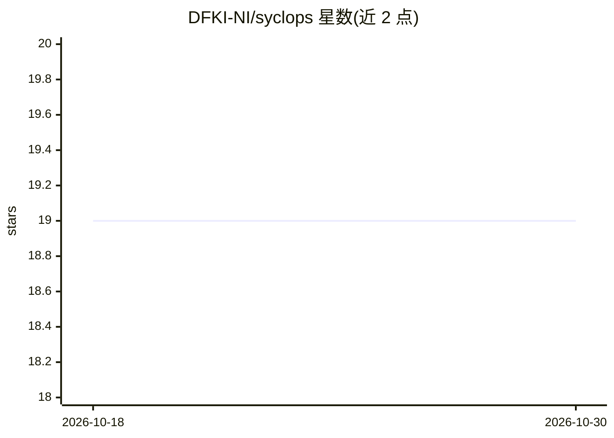

# DFKI-NI/syclops

⭐ 19 · Python · GPL-3.0 · 推送 2026-07-10 · [GitHub](https://github.com/DFKI-NI/syclops) · 组织维护

**从 3D 虚拟环境生成带标注合成数据的工具**

Syclops 基于 3D 虚拟环境生成光真实感渲染图像，并输出像素级精确标注，包括语义分割、实例分割、深度图、边界框、点云、关键点等十余种输出格式。用户通过 YAML 文件以无代码方式配置场景与传感器，可借助随机化工具提升数据多样性，并通过资产管理系统跨场景复用资产。以 pip 包提供，支持 Python 3.9-3.11，当前不支持 macOS，推荐 Linux 或 Windows。由 DFKI 在 Agri-Gaia 研究项目中开发，附 JOSS 论文。

## 筛选速览

| 维度 | 判定 | 备注 |
|---|---|---|
| AI 角色 | `ai-ecosystem` | LLM/agent 周边工具 |
| 许可风险 | `viral` | GPL-3.0 |
| 部署形态 | `desktop` | 安装包/桌面程序 |
| 模型依赖 | — | README 未给出锁定关系 |
| 硬件要求 | — | 无带数字的原话,不猜 |
| 安装摩擦 | `low` | 无编译、无系统依赖或容器化 |
| 成熟度 | — | 结构信号不足 |

## 能力要点

- 光真实感渲染并输出像素级精确标注（分割/深度/边界框/点云/关键点等）
- YAML 无代码配置场景与传感器
- 随机化工具提升生成数据多样性
- 资产管理与查看器支持跨场景复用资产

## 适用场景

- 为计算机视觉模型训练生成带精确标注的合成数据集
- 通过随机化扩展数据多样性以覆盖更多场景
- 复用 3D 资产批量生成多场景数据

## 场景标签

 · 领域:计算机视觉/合成数据生成

## 证据(README 行号)

> L8:  Syclops is a tool for creating synthetic data from 3D virtual environments.
> L16: 📷 Photorealistic renderings of the virtual environment with pixel-perfect annotations

## 星数曲线

2026-10-18 19 → 2026-10-30 19（+0）

---
*卡片 v1 · prompt 1.4 · 生成 2026-10-29 · 置信度 high · 依据 README sha `9fb64eda8d00` · [字段定义](../../DATASET.md)*
