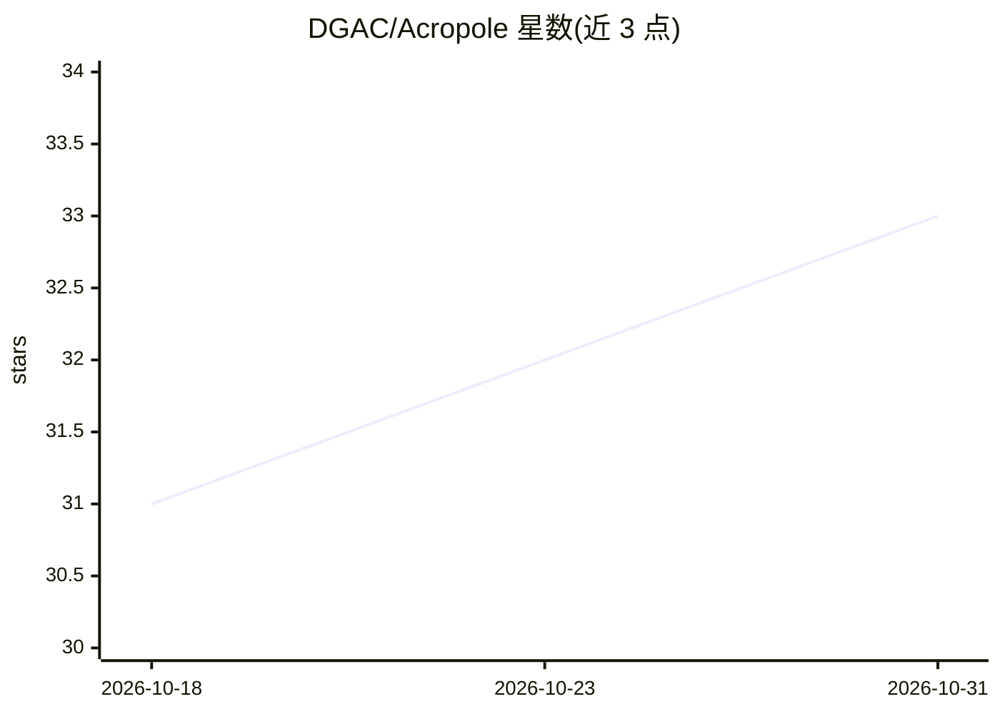

# DGAC/Acropole

⭐ 33 · Python · AGPL-3.0 · 推送 2026-10-26 · [GitHub](https://github.com/DGAC/Acropole) · 组织维护

**从飞行轨迹数据预测飞机燃油流量的 ONNX 模型库**

Python 库 acropole，基于 QAR 数据训练的神经网络（ONNX 格式），输入含机型代码、地速、高度、垂直速度的 pandas/polars DataFrame，输出逐样本燃油流量（kg/s、kg/h）与累计油耗。按机型分发参数，支持多机型混合帧、自定义机型参数与模型路径、列名映射。运行时仅依赖 numpy + polars + onnxruntime，另提供 CLI 读取 CSV/parquet 并写回结果。由法国民航局（DGAC）维护，附 2024 年 ICRAT 论文。

## 筛选速览

| 维度 | 判定 | 备注 |
|---|---|---|
| AI 角色 | `ai-native` | 本体是模型或模型工具 |
| 许可风险 | `viral` | AGPL-3.0 |
| 部署形态 | `library` | 以包/库形式分发 |
| 模型依赖 | — | README 未给出锁定关系 |
| 硬件要求 | — | 无带数字的原话,不猜 |
| 安装摩擦 | `low` | 无编译、无系统依赖或容器化 |
| 成熟度 | — | 结构信号不足 |

## 能力要点

- ONNX 模型预测逐样本燃油流量与累计油耗，按机型分发
- 同时接受 pandas 与 polars DataFrame，支持多机型混合帧
- 运行时仅依赖 numpy + polars + onnxruntime，无需重型 ML 框架
- 内置 acropole CLI：读取 CSV/parquet 估算并写回结果

## 适用场景

- 对 ADS-B 或 QAR 轨迹数据批量估算飞机油耗
- 航空减排与环境影响分析中计算燃油消耗
- 处理含多机型的轨迹数据集并生成燃油列

## 场景标签

`数据分析` · 领域:效率与自动化

## 证据(README 行号)

> L14: `acropole` predicts the **fuel flow of aircraft** (kg/s, kg/h and cumulative kg) from
> L15: trajectory data — groundspeed, altitude and vertical rate — using a portable **ONNX**
> L16: model trained on Quick Access Recorder (QAR) data. It accepts a **pandas or polars**

## 星数曲线

2026-10-18 31 → 2026-10-31 33（+2）

---
*卡片 v1 · prompt 1.4 · 生成 2026-10-26 · 置信度 high · 依据 README sha `ff430a858214` · [字段定义](../../DATASET.md)*
