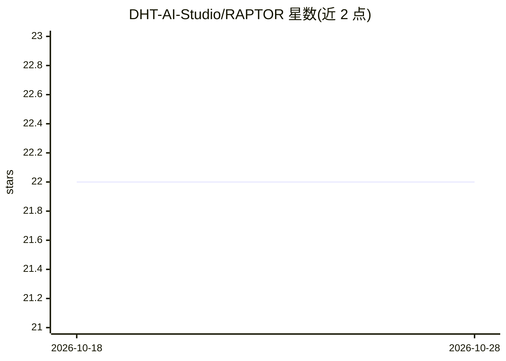

# DHT-AI-Studio/RAPTOR

⭐ 22 · Python · Apache-2.0 · 推送 2026-10-06 · [GitHub](https://github.com/DHT-AI-Studio/RAPTOR) · 组织维护

**构建多模态智能体应用的企业级开源 AI 运行时框架**

由 DHT Taiwan Team（DHT Solutions）开发的开源多模态 AI 框架与 agent harness：以 27 个可独立部署的 Docker Compose 模块组成，面向视频、音频、图像、文档与组织知识构建智能体应用。提供 MCP 工具、A2A 编排、持久化多模态记忆（MemVID）、每用户隔离的 ArcadeDB 混合检索（BM25+向量+图+时序事实）、GraphRAG、评测基准、LLM 护栏与模型生命周期服务，以 REST/MCP/A2A 接口暴露。需要 Ollama 推理服务器，GPU 主机要求 CUDA 12.8+、24GB+ 显存。当前为 Aigle 0.4 社区 Beta 版。

## 筛选速览

| 维度 | 判定 | 备注 |
|---|---|---|
| AI 角色 | `ai-ecosystem` | LLM/agent 周边工具 |
| 许可风险 | `permissive` | Apache-2.0 |
| 部署形态 | `self-host` | docker 或自建部署 |
| 模型依赖 | local-ok | 支持本地模型 |
| 硬件要求 | `gpu-24g` | |
| 安装摩擦 | `low` | 无编译、无系统依赖或容器化 |
| 成熟度 | `idea` | |

## 能力要点

- 27 个可独立部署的 Docker Compose 模块，单一构建入口 build.py
- MCP Server / A2A 编排 / REST 三类接口暴露全部能力
- 每用户物理隔离的 ArcadeDB 统一混合检索（BM25+向量+图+时序事实）
- 护栏服务支持 Llama Guard 3 / Granite Guardian / GPT-OSS-Safeguard 可插拔模型
- 上传媒体自动完成转录、OCR、摘要、嵌入与知识图谱构建

## 适用场景

- 企业内搭建面向视频/音频/文档的 RAG 问答与检索平台
- 通过 MCP/A2A 接入 LLM agent 或其他 agent 框架调用检索与记忆能力
- 对 chat/RAG/搜索管道做回归基准评测与内容安全审计
- 不搭基础设施直接用官方测试 API 做概念验证

## 场景标签

`Agent 框架` `RAG` `知识图谱` `模型评测` · 领域:Agent 开发

## 证据(README 行号)

> L31: **RAPTOR** is an enterprise AI runtime for building agentic applications over video, audio, images, documents, and 
> L74: **RAPTOR** is an open-source **multimodal AI framework and agent harness** — an enterprise AI runtime for building 
> L86: 1. **Agent-Native Interfaces**: MCP tools and A2A orchestration (agent cards, JSON-RPC, five spec-compliant sub-age

## 星数曲线

2026-10-18 22 → 2026-10-28 22（+0）

---
*卡片 v1 · prompt 1.4 · 生成 2026-10-27 · 置信度 high · 依据 README sha `fecb0e580f75` · [字段定义](../../DATASET.md)*
