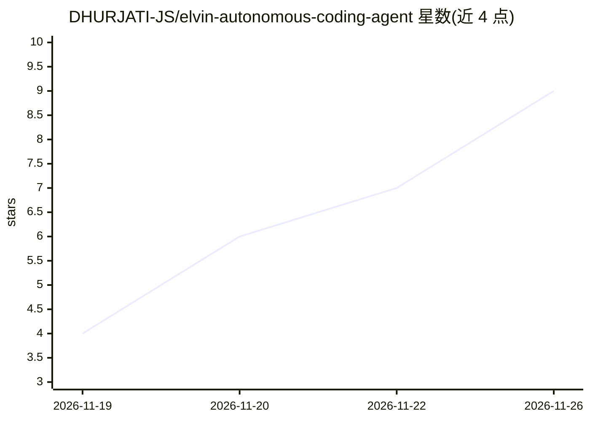

# DHURJATI-JS/elvin-autonomous-coding-agent

⭐ 9 · Python · MIT · 推送 2026-11-18 · [GitHub](https://github.com/DHURJATI-JS/elvin-autonomous-coding-agent) · 个人维护

**本地优先的自主编码 agent：规划、写码、测试并修复，行动前征求批准**

以 FastAPI + Docker 运行的本地编码 agent 平台：用户描述改动后，Elvin 规划任务、经 OSV.dev 检查依赖库、生成多文件代码、弹出带精确 diff 的权限对话框等待批准，批准后崩溃安全地应用更改、保存带时间戳的版本、在沙箱中运行测试并修复失败。默认使用本地 Gemma 3（网关）+ Qwen Coder（GPU），Docker 中 CPU 模型作自动回退，Claude 与 ChatGPT 为可选云端模型。附带代码编辑器（ghost-text 补全）、漏洞扫描、Locust 压测、GitHub 推送与克隆、版本历史等工具。

## 筛选速览

| 维度 | 判定 | 备注 |
|---|---|---|
| AI 角色 | `ai-native` | 本体是模型或模型工具 |
| 许可风险 | `permissive` | MIT |
| 部署形态 | `self-host` | docker 或自建部署 |
| 模型依赖 | local-ok | 支持本地模型 |
| 硬件要求 | `gpu-8g` | |
| 安装摩擦 | `low` | 无编译、无系统依赖或容器化 |
| 成熟度 | — | 结构信号不足 |

## 能力要点

- 权限对话框机制：每次写入、命令与压测均需批准，删除还需密码
- 崩溃安全设计：write-ahead 日志、带时间戳的版本、Stop 可还原
- 依赖供应链检查：接入 OSV.dev，拦截虚构与恶意包
- 多模型分工与自动回退：Gemma 3 规划、Qwen Coder 写码、Claude/ChatGPT 可选

## 适用场景

- 让 agent 在本地完成一个功能的规划、编码、测试与修复
- 截图生成前端界面并迭代比对
- 对项目依赖做漏洞扫描并一键最小升级
- 对本地服务发起 Locust 压力测试并导出 CSV

## 场景标签

`编码 Agent` `代码生成` `网络安全` · 领域:编码与开发

## 证据(README 行号)

> L16: **Plan → check every library → write → ask permission → apply crash-safely → timestamp & verify → test in a sandbox
> L29: - 🤖 **An agent, not just autocomplete.** Describe a change; Elvin plans it, writes multi-file code, runs your tests
> L66: |🤖|**Elvin AI**|Chat with an autonomous coding agent. Elvin plans the work, checks every library it wants to use, w

## 星数曲线

2026-11-19 4 → 2026-11-26 9（+5）

---
*卡片 v1 · prompt 1.4 · 生成 2026-11-20 · 置信度 mid · 依据 README sha `2312970fccc7` · [字段定义](../../DATASET.md)*
