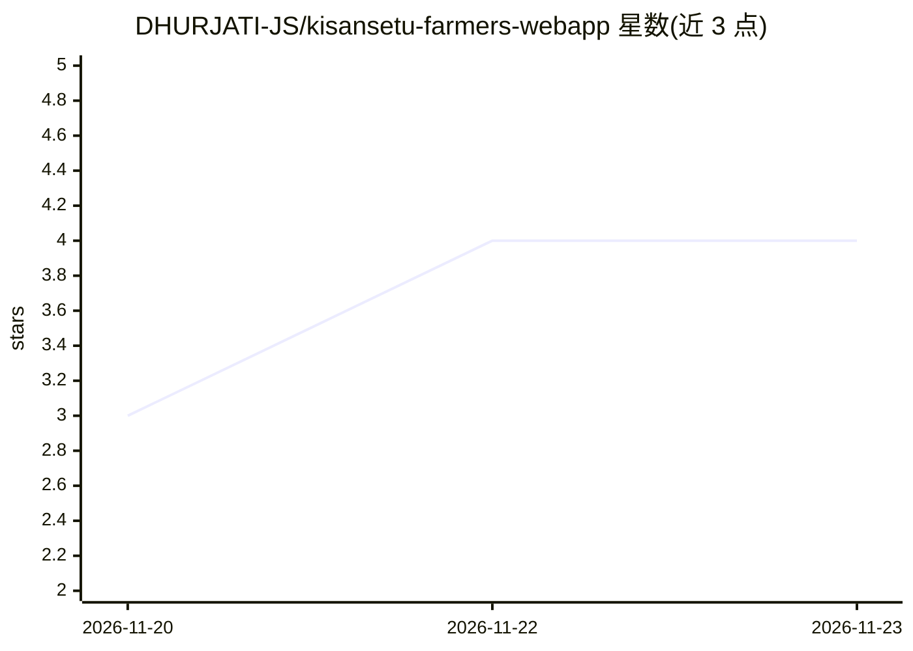

# DHURJATI-JS/kisansetu-farmers-webapp

⭐ 4 · Python · MIT · 推送 2026-11-19 · [GitHub](https://github.com/DHURJATI-JS/kisansetu-farmers-webapp) · 个人维护

**面向印度农户的用工/薪酬/农贸 Web 应用，含多语言 AI 助手**

为印度农场三方群体（工人、农场主、买家）提供的用工平台：就近求职、日结工资、OCR 支付凭证、GSTIN 验证、农场商店、政府补贴资格检查。技术栈为 FastAPI + PostgreSQL(pgvector) + Redis，Python 3.12。AI 功能包括：以用户书写语言回答的 Kisan Mitra 助手（只读数据、改动需按 GO 确认）、Gemma 视觉参与 GSTIN 证书识别投票、AI 翻译补全缺失界面文案、条款风险标注。仅限印度使用，定位为学生级教学项目，MIT 许可。

## 筛选速览

| 维度 | 判定 | 备注 |
|---|---|---|
| AI 角色 | `ai-enhanced` | 去掉 AI 部分产品仍成立 |
| 许可风险 | `permissive` | MIT |
| 部署形态 | `desktop` | 安装包/桌面程序 |
| 模型依赖 | local-ok | 支持本地模型 |
| 硬件要求 | — | 无带数字的原话,不猜 |
| 安装摩擦 | `low` | 无编译、无系统依赖或容器化 |
| 成熟度 | `idea` | |

## 能力要点

- Kisan Mitra AI 助手用本人数据回答，只提建议、改动需按 GO 确认
- GSTIN 证书识别采用 Tesseract + RapidOCR + Gemma vision 三引擎投票
- 30 种印度语言界面，AI 补全缺失翻译键并缓存
- OCR 读取支付截图作为薪酬凭证，金额不可手输

## 适用场景

- 农场主雇工、发薪并出售农产品
- 农场工人在 30 公里内找有最低工资保障的工作
- 买家直接从认证农场购买并询问产品信息
- 低识字率用户通过语音和图像向导完成操作

## 场景标签

`AI 助手` `OCR` · 领域:对话与助手

## 证据(README 行号)

> L132: |**Vernacular AI**|The assistant, plant doctor, product Ask-AI and terms explainer answer in the language the pers
> L135: |**GSTIN**|Certificate photo → Tesseract + RapidOCR + Gemma vision, checksum validation & majority vote → GST API 
> L44: kept, and nobody to call when something goes wrong. KisanSetu builds the protections into the software itself —

## 星数曲线

2026-11-20 3 → 2026-11-23 4（+1）

---
*卡片 v1 · prompt 1.4 · 生成 2026-11-22 · 置信度 high · 依据 README sha `6012c9d16ad1` · [字段定义](../../DATASET.md)*
