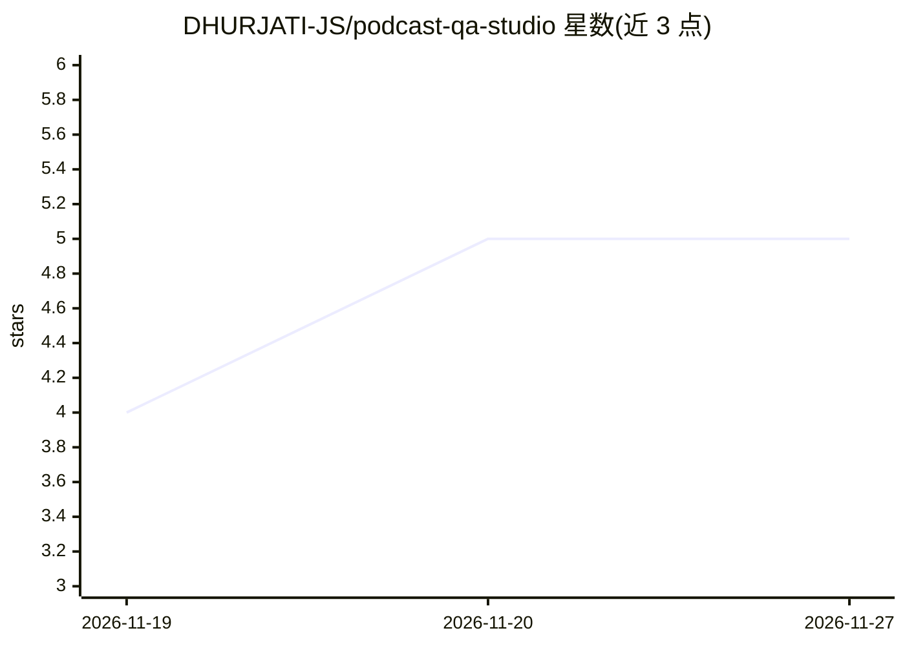

# DHURJATI-JS/podcast-qa-studio

⭐ 5 · Python · MIT · 推送 2026-11-17 · [GitHub](https://github.com/DHURJATI-JS/podcast-qa-studio) · 个人维护

**播客主持人与嘉宾的 AI 助手：生成、检查、计时问题并陪练回答**

一个本地优先的播客准备应用，提供两种模式：主持人从主题、嘉宾与受众生成有序问题流（支持改写、撤销、重复检测与时间规划）；嘉宾接受模拟面试，获得 0-10 评分、改进建议与更强改写。技术栈为 FastAPI、PostgreSQL 17 + pgvector、Redis、Socket.IO，AI 默认走本地 Gemma（Docker 内 Ollama），提供 LAN 网关、Claude、ChatGPT 的逐级回退链，配 Kokoro TTS 与口型同步头像，macOS/Windows 提供一键安装脚本。

## 筛选速览

| 维度 | 判定 | 备注 |
|---|---|---|
| AI 角色 | `ai-native` | 本体是模型或模型工具 |
| 许可风险 | `permissive` | MIT |
| 部署形态 | `self-host` | docker 或自建部署 |
| 模型依赖 | local-ok | 支持本地模型 |
| 硬件要求 | — | 无带数字的原话,不猜 |
| 安装摩擦 | `low` | 无编译、无系统依赖或容器化 |
| 成熟度 | — | 结构信号不足 |

## 能力要点

- pgvector 嵌入 + AI 复核的双重重复问题检测
- 多 provider 回退链：LAN 网关 → 本地 Gemma → Claude → ChatGPT
- Kokoro TTS 语音朗读与口型同步头像
- 问题质量检查：yes/no、双管、引导性提问标记与时间槽规划

## 适用场景

- 为播客访谈从主题生成并打磨计时问题清单
- 录制前模拟面试并获取答案评分与改进建议
- 跨集检测重复问题与重复讲述的故事
- 完全离线的本地 AI 环境下运行整个流程

## 场景标签

`AI 助手` `语音合成` · 领域:对话与助手

## 证据(README 行号)

> L3:  An AI co-host that writes, checks and times your podcast questions, or interviews you and coaches every answer.
> L47: ||**AI outages**|LAN gateway → local Docker Gemma → Claude → ChatGPT; if none can answer, you're told exactly why|

## 星数曲线

2026-11-19 4 → 2026-11-27 5（+1）

---
*卡片 v1 · prompt 1.4 · 生成 2026-11-21 · 置信度 high · 依据 README sha `bdeb545cfd09` · [字段定义](../../DATASET.md)*
