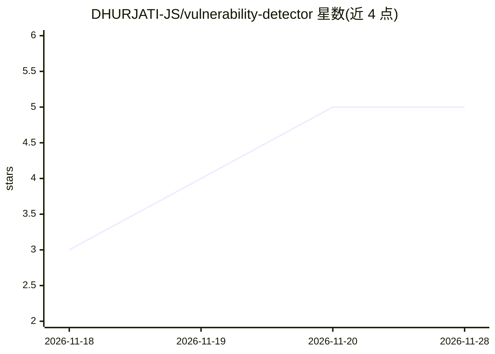

# DHURJATI-JS/vulnerability-detector

⭐ 5 · Python · MIT · 推送 2026-11-15 · [GitHub](https://github.com/DHURJATI-JS/vulnerability-detector) · 个人维护

**本地运行的 Python 依赖漏洞扫描器：OSV 公告+本地 Gemma 审查**

扫描 requirements.txt 或整个项目文件夹：读取 pip 依赖与 Python import（AST 解析并映射到 PyPI 项目），查询 OSV.dev 公告与 PyPI 元数据，再用 Docker 内经 Ollama 本地运行的 Gemma 3 做规则基线之上的审查，失败时回退到 Claude API。所有建议版本重新经 OSV 核验，扫描任务以 PostgreSQL 队列并行处理并保留历史。声明为学生级项目、供学习与个人使用，代码不出本机。

## 筛选速览

| 维度 | 判定 | 备注 |
|---|---|---|
| AI 角色 | `ai-enhanced` | 去掉 AI 部分产品仍成立 |
| 许可风险 | `permissive` | MIT |
| 部署形态 | `self-host` | docker 或自建部署 |
| 模型依赖 | local-ok | 支持本地模型 |
| 硬件要求 | — | 无带数字的原话,不猜 |
| 安装摩擦 | `low` | 无编译、无系统依赖或容器化 |
| 成熟度 | — | 结构信号不足 |

## 能力要点

- OSV.dev 真实公告 + PyPI 元数据为基准，建议版本重新经 OSV 核验
- Gemma 3 经 Ollama 在 Docker 本地运行，schema 约束 JSON 输出，Claude 作为回退
- 支持 requirements.txt（≤10MB）与项目文件夹（≤30 个 .py 文件）的 import 扫描
- PostgreSQL 任务队列（FOR UPDATE SKIP LOCKED）并行处理，扫描历史可搜索

## 适用场景

- 在部署前扫描 requirements.txt 找出已知 CVE 与升级路径
- 检查小型 Python 项目 import 了哪些有漏洞的包
- 本地单机环境下做依赖安全学习与自检（含 selfscan 自诊断）

## 场景标签

`网络安全` · 领域:学习与行业

## 证据(README 行号)

> L7: Upload a `requirements.txt` or a whole project folder. Real advisories from OSV.dev are cross-checked by
> L18:  Gemma via Ollama
> L96: Advisories come from **OSV.dev** and metadata from **PyPI**. The AI can't hide a known vulnerability, invent

## 星数曲线

2026-11-18 3 → 2026-11-28 5（+2）

---
*卡片 v1 · prompt 1.4 · 生成 2026-11-21 · 置信度 mid · 依据 README sha `60a061473590` · [字段定义](../../DATASET.md)*
