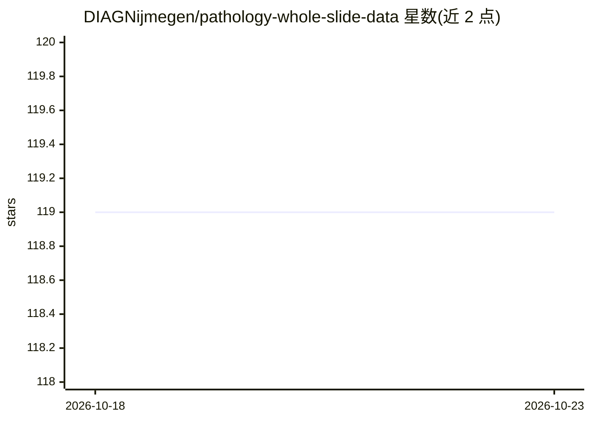

# DIAGNijmegen/pathology-whole-slide-data

⭐ 119 · Python · Apache-2.0 · 推送 2025-11-08 · [GitHub](https://github.com/DIAGNijmegen/pathology-whole-slide-data) · [官网](https://diagnijmegen.github.io/pathology-whole-slide-data/) · 组织维护

**病理全切片图像与标注的批量采样库：为训练深度学习模型高效取 patch**

面向计算病理学的 Python 包：读取多厂商全切片图像（WSI）及 ASAP、QuPath、Virtum、Histomicstk 等标注软件的标注数据。核心是一个快速批迭代器，通过 Concurrent Buffer 共享内存多进程动态生成 patch 与标签，无需落盘保存静态数据集；标注以 JSON 内部存储并用 Shapely 做几何计算。基于 Dicfg 配置系统（与 Hydra 类似）定义采样策略（random/balanced/area-based 等）与回调。支持 openslide（默认）、asap、pyvips、tiffslide、cucim 五种图像后端，至少需安装其一。当前处于 major version 0，API 不保证稳定。

## 筛选速览

| 维度 | 判定 | 备注 |
|---|---|---|
| AI 角色 | `ai-ecosystem` | LLM/agent 周边工具 |
| 许可风险 | `permissive` | Apache-2.0 |
| 部署形态 | `library` | 以包/库形式分发 |
| 模型依赖 | — | README 未给出锁定关系 |
| 硬件要求 | — | 无带数字的原话,不猜 |
| 安装摩擦 | `low` | 无编译、无系统依赖或容器化 |
| 成熟度 | `idea` | |

## 能力要点

- Concurrent Buffer 共享内存多进程动态生成 patch 与标签，无需预存磁盘
- 内部 JSON 标注 + Shapely 几何计算，内存占用低于转 mask 方案
- 支持 ASAP/QuPath/Virtum/Histomicstk 标注与 5 种图像后端
- Dicfg 单文件配置采样策略与回调（fit_shape、one-hot、albumentations 等）

## 适用场景

- 训练病理图像深度学习模型时高效采样 patch 数据
- 在不同 patch 形状/放大倍率间灵活切换的数据管线
- 读取并查询多厂商 WSI 及配套标注

## 场景标签

`MLOps` · 领域:训练与推理

## 证据(README 行号)

> L16: WholeSlideData aims to provide the tools to work with whole slide images and annotations from different vendors and
> L42: Wholeslidedata supports various image backends. You will have to install at least one of these image backends.

## 星数曲线

2026-10-18 119 → 2026-10-23 119（+0）

---
*卡片 v1 · prompt 1.4 · 生成 2026-10-23 · 置信度 high · 依据 README sha `b43801659073` · [字段定义](../../DATASET.md)*
