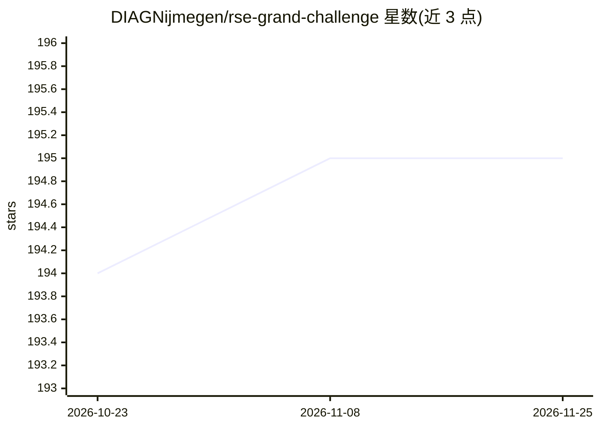

# DIAGNijmegen/rse-grand-challenge

⭐ 195 · Python · Apache-2.0 · 推送 2026-11-23 · [GitHub](https://github.com/DIAGNijmegen/rse-grand-challenge) · [官网](https://grand-challenge.org) · 组织维护

**生物医学影像机器学习方案协作开发平台**

grand-challenge.org 是一个面向生物医学影像机器学习方案的端到端开发平台，以 Django 网站框架形式提供。平台提供四类核心机制：Archives 管理医学影像数据，Reader Studies 支持专家对影像进行标注训练，Challenges 汇集与评估机器学习方案，Algorithms 将方案部署用于临床验证。面向研究人员、数据科学家与临床医生协作使用，强调标注数据获取、方案公平比较与真实世界数据验证。

## 筛选速览

| 维度 | 判定 | 备注 |
|---|---|---|
| AI 角色 | `ai-ecosystem` | LLM/agent 周边工具 |
| 许可风险 | `permissive` | Apache-2.0 |
| 部署形态 | `None` |  |
| 模型依赖 | — | README 未给出锁定关系 |
| 硬件要求 | — | 无带数字的原话,不猜 |
| 安装摩擦 | `low` | 无编译、无系统依赖或容器化 |
| 成熟度 | — | 结构信号不足 |

## 能力要点

- Archives 管理医学影像数据
- Reader Studies 支持专家标注影像数据
- Challenges 汇集与评估机器学习方案
- Algorithms 部署方案用于临床验证

## 适用场景

- 组织医学影像标注与专家培训
- 举办机器学习算法挑战赛并评估方案
- 将医学影像算法部署到真实世界数据上做临床验证

## 场景标签

`模型评测` `科研工具` `MLOps` · 领域:评测与运维

## 证据(README 行号)

> L8: In the era of Deep Learning, developing robust machine learning solutions to problems in biomedical imaging requires
> L10: - Archives: Manage medical imaging data.
> L12: - Challenges: Gather and assess machine learning solutions.

## 星数曲线

2026-10-23 194 → 2026-11-25 195（+1）

---
*卡片 v1 · prompt 1.4 · 生成 2026-11-25 · 置信度 mid · 依据 README sha `15d61b6471b2` · [字段定义](../../DATASET.md)*
