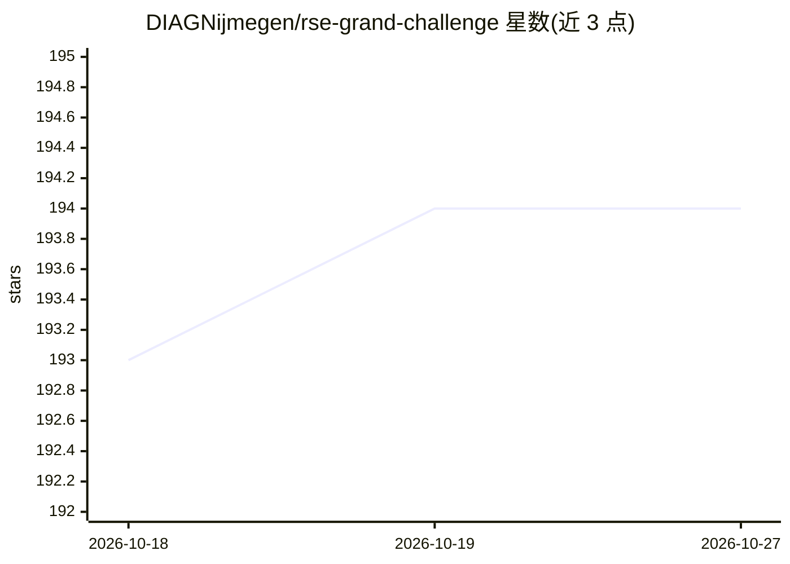

# DIAGNijmegen/rse-grand-challenge

⭐ 194 · Python · Apache-2.0 · 推送 2026-10-26 · [GitHub](https://github.com/DIAGNijmegen/rse-grand-challenge) · [官网](https://grand-challenge.org) · 组织维护

**生物医学影像机器学习全流程开发平台**

基于 Django/Django REST Framework 的生物医学影像机器学习平台，面向研究人员、数据科学家和临床医生，提供四类功能：影像数据档案管理、供专家标注数据的阅读研究、征集并评估机器学习方案的挑战赛，以及部署算法进行临床验证。用于协作开发稳健的机器学习解决方案，涉及数据标注、方案对比与真实数据验证等环节。部署方式详见其文档。

## 筛选速览

| 维度 | 判定 | 备注 |
|---|---|---|
| AI 角色 | `ai-ecosystem` | LLM/agent 周边工具 |
| 许可风险 | `permissive` | Apache-2.0 |
| 部署形态 | `None` |  |
| 模型依赖 | — | README 未给出锁定关系 |
| 硬件要求 | — | 无带数字的原话,不猜 |
| 安装摩擦 | `low` | 无编译、无系统依赖或容器化 |
| 成熟度 | — | 结构信号不足 |

## 能力要点

- Archives：管理医学影像数据
- Reader Studies：供专家训练与标注影像数据
- Challenges：征集并评估机器学习解决方案
- Algorithms：部署算法用于临床验证

## 适用场景

- 组织医学影像机器学习挑战赛并做公平比较
- 管理标注医学影像数据集
- 部署算法进行真实世界临床数据验证

## 场景标签

`模型评测` · 领域:评测与运维

## 证据(README 行号)

> L8: In the era of Deep Learning, developing robust machine learning solutions to problems in biomedical imaging requires
> L10: * Archives: Manage medical imaging data.
> L13: * Algorithms: Deploy machine learning solutions for clinical validation.

## 星数曲线

2026-10-18 193 → 2026-10-27 194（+1）

---
*卡片 v1 · prompt 1.4 · 生成 2026-10-22 · 置信度 mid · 依据 README sha `00a60a1abd19` · [字段定义](../../DATASET.md)*
