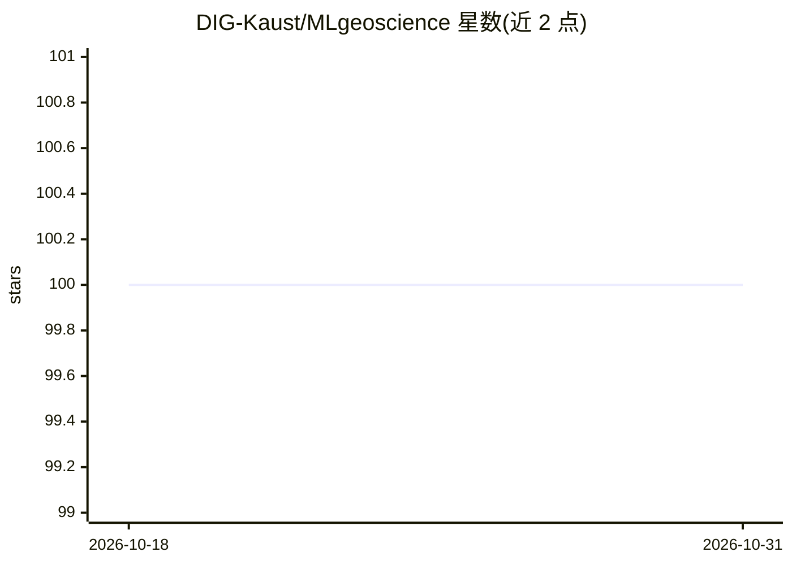

# DIG-Kaust/MLgeoscience

⭐ 100 · Jupyter Notebook · 推送 2025-12-30 · [GitHub](https://github.com/DIG-Kaust/MLgeoscience) · [官网](https://dig-kaust.github.io/MLgeoscience/) · 组织维护

**KAUST 地球科学机器学习课程的教案与实验材料**

KAUST ErSE 222《Machine Learning in Geoscience》课程的教学材料仓库，分为两部分：Docs 为用 MKDocs 编写并在线渲染的课程讲义；Labs 为实践环节使用的 Python 代码与 Jupyter Notebook。内容面向修读该课程的学生与自学者，围绕地球科学场景下的机器学习方法组织。仓库以许可证条款发布（README 中许可证名称未完整展示）。

## 筛选速览

| 维度 | 判定 | 备注 |
|---|---|---|
| AI 角色 | `ai-knowledge` | 知识聚合/清单类 |
| 许可风险 | `none` | — |
| 部署形态 | `None` |  |
| 模型依赖 | — | README 未给出锁定关系 |
| 硬件要求 | — | 无带数字的原话,不猜 |
| 安装摩擦 | `low` | 无编译、无系统依赖或容器化 |
| 成熟度 | — | 结构信号不足 |

## 能力要点

- MKDocs 编写的课程讲义，在线渲染可读
- Labs 含实践环节的 Python 代码与 Jupyter Notebook
- 面向地球科学（Geoscience）领域的机器学习课程

## 适用场景

- 修读或自学 ErSE 222 课程的讲义与实验
- 参考地球科学领域的机器学习教学案例与代码

## 场景标签

`教程课程` · 领域:学习与行业

## 证据(README 行号)

> L3: Teaching material for ErSE 222 Machine Learning in Geoscience course to be held at KAUST during the Spring semester.
> L10: - **Labs**: Python codes and Jupyter Notebooks used in the practical sessions. See inside for details.

## 星数曲线

2026-10-18 100 → 2026-10-31 100（+0）

---
*卡片 v1 · prompt 1.4 · 生成 2026-10-23 · 置信度 high · 依据 README sha `bad38edda6a5` · [字段定义](../../DATASET.md)*
