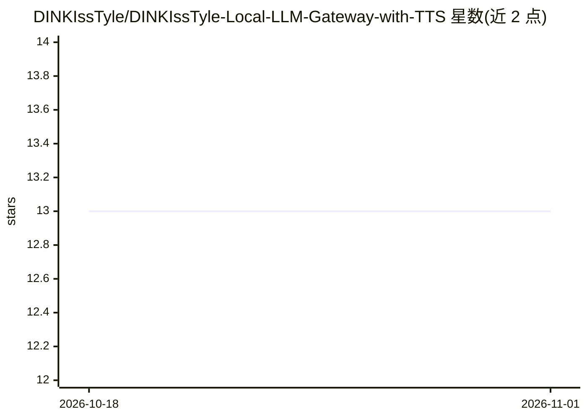

# DINKIssTyle/DINKIssTyle-Local-LLM-Gateway-with-TTS

⭐ 13 · Go · 推送 2026-10-11 · [GitHub](https://github.com/DINKIssTyle/DINKIssTyle-Local-LLM-Gateway-with-TTS) · 个人维护 · 中文 README

**本地 LLM 聊天服务器：整合多模型供应商与 Supertonic TTS**

基于 Wails 的桌面应用与网关服务器，提供本地 LLM 网页聊天界面，接入 LM Studio 与 OpenAI 兼容 API 等供应商。内置应用内工具运行时（网页搜索、记忆与系统工具、多模态视觉），并结合 Supertonic TTS 引擎做 CPU 多线程语音合成与实时流式输出。记忆系统采用 FTS5+Vector 混合检索、SQLite 存储、用户画像记忆与基于评分的遗忘机制；嵌入模型使用 multilingual-e5-small，通过 ONNX Runtime 运行。构建需 Go 1.18+、Node.js 与 Wails CLI，提供 macOS/Windows/Linux 构建脚本，界面以韩语文档为主。

## 筛选速览

| 维度 | 判定 | 备注 |
|---|---|---|
| AI 角色 | `ai-native` | 本体是模型或模型工具 |
| 许可风险 | `none` | — |
| 部署形态 | `library` | 以包/库形式分发 |
| 模型依赖 | — | README 未给出锁定关系 |
| 硬件要求 | — | 无带数字的原话,不猜 |
| 安装摩擦 | `low` | 无编译、无系统依赖或容器化 |
| 成熟度 | — | 结构信号不足 |

## 能力要点

- FTS5+Vector 混合检索的长期记忆系统（SQLite 存储）
- Supertonic TTS：CPU 多线程合成、韩语发音词典、实时流式输出
- 供应商无关的内置工具运行时（网页搜索/记忆/系统工具/视觉）
- 用户画像记忆与评分制智能遗忘机制

## 适用场景

- 在本地用 LM Studio 等 LLM 搭建带语音输出的个人聊天助手
- 让 AI 记住个人信息并在长期对话中个性化回答
- 通过统一 HTTP API 在本地使用多种 LLM 供应商

## 场景标签

`聊天机器人` `Agent 记忆` `语音合成` `模型网关` · 领域:Agent 开发

## 证据(README 行号)

> L7: DKST LLM Chat Server는 강력한 지능형 기능을 결합한 차세대 로컬 LLM 웹 인터페이스입니다. LM Studio, OpenAI 호환 API 등 다양한 모델 공급자와 앱 내부 도구 런타임, Sup
> L23: ### 3. 고성능 TTS (Supertonic2)
> L50: 1. 앱 실행 후 **Start Server**를 클릭합니다.

## 星数曲线

2026-10-18 13 → 2026-11-01 13（+0）

---
*卡片 v1 · prompt 1.4 · 生成 2026-10-31 · 置信度 high · 依据 README sha `2f7bdee9a988` · [字段定义](../../DATASET.md)*
