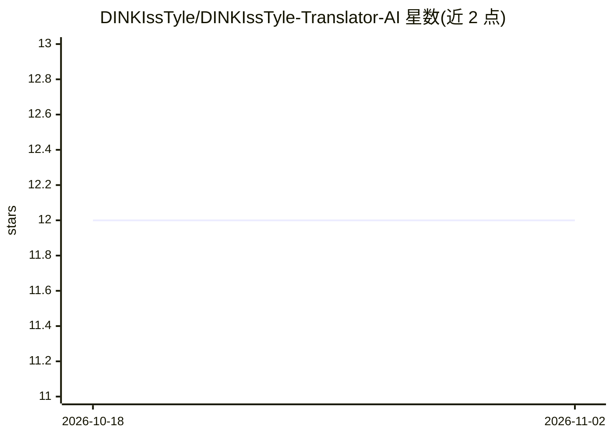

# DINKIssTyle/DINKIssTyle-Translator-AI

⭐ 12 · TypeScript · 推送 2026-08-21 · [GitHub](https://github.com/DINKIssTyle/DINKIssTyle-Translator-AI) · 个人维护 · 中文 README

**本地 LLM 长文翻译工作台，保持风格与上下文一致**

面向长文翻译的桌面工作台（Wails v3 / Go + 前端），通过 OpenAI 兼容 API 或 LM Studio 调用本地 LLM 完成翻译。机制包括：自定义翻译提示词与温度控制、低温初译加后编辑润色的两步流程、用户术语表保证专名一致、跨段落上下文保持防止语气漂移。支持保留版式的文本型 PDF 翻译、带密码与 SSL/TLS 的内置 Web 服务器、跨平台（Windows/macOS/Linux/Android/iOS）运行 .litertlm Gemma 模型的端侧 LiteRT-LM。限制：PDF 翻译需可选择文本，扫描件须先 OCR。生产构建须用各平台自带脚本而非原生 wails3 build。

## 筛选速览

| 维度 | 判定 | 备注 |
|---|---|---|
| AI 角色 | `ai-native` | 本体是模型或模型工具 |
| 许可风险 | `none` | — |
| 部署形态 | `desktop` | 安装包/桌面程序 |
| 模型依赖 | — | README 未给出锁定关系 |
| 硬件要求 | — | 无带数字的原话,不猜 |
| 安装摩擦 | `low` | 无编译、无系统依赖或容器化 |
| 成熟度 | — | 结构信号不足 |

## 能力要点

- 低温初译 + 后编辑润色的两步翻译流程
- 用户术语表与上下文感知后编辑，维持长文一致性
- 保留原版式（页面/图片/分栏/页数）的文本型 PDF 翻译
- 端侧 LiteRT-LM 运行 .litertlm Gemma 模型，支持五大平台

## 适用场景

- 在本地 LLM 上翻译长文档并保持术语和风格一致
- 翻译文本型 PDF 并保留原始版式
- 通过浏览器远程访问翻译工作台（带密码与 TLS）

## 场景标签

`AI 写作` · 领域:内容生成

## 证据(README 行号)

> L16: **DKST Translator AI** is a powerful translation tool designed for translating long-form content while maintaining 
> L24: - **Layout-Preserving PDF Translation**: Open text-based PDFs in the desktop app, preview source and translated pag
> L26: - **On-device LiteRT-LM**: Run a `.litertlm` Gemma model locally on Windows, macOS, Linux, Android, and iOS, with a

## 星数曲线

2026-10-18 12 → 2026-11-02 12（+0）

---
*卡片 v1 · prompt 1.4 · 生成 2026-11-01 · 置信度 high · 依据 README sha `ca14112e0716` · [字段定义](../../DATASET.md)*
