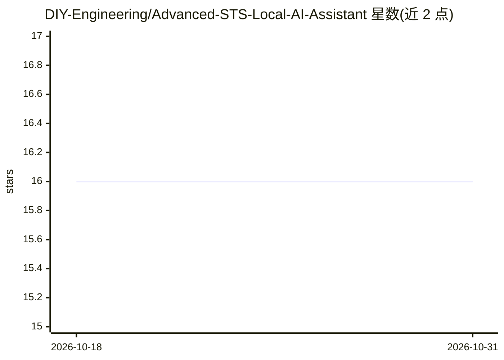

# DIY-Engineering/Advanced-STS-Local-AI-Assistant

⭐ 16 · Python · GPL-3.0 · 推送 2026-08-22 · [GitHub](https://github.com/DIY-Engineering/Advanced-STS-Local-AI-Assistant) · [官网](https://www.youtube.com/@DIY_Engineering/featured) · 个人维护

**全离线语音对话 AI 助手桌面应用：语音识别+本地 LLM+语音合成+RAG**

Windows 桌面应用，面向注重隐私的个人用户，实现端到端语音到语音的本地 AI 对话链路：Faster-Whisper（配合 Silero VAD）做语音识别，经 LM Studio 本地服务器调用任意本地 LLM，Coqui XTTS-V2 做可克隆语音合成，MiniLM-L6-v2 + ChromaDB 构建按配置文件隔离的长期记忆与文档检索（.pdf/.txt）。另带 MCP 插件系统，支持 Google 服务、Windows CLI、Home Assistant、Telegram、Signal 等扩展。限制：仅支持 Windows 10/11、Python 3.12.6，需 GTX 1060 6GB 以上 GPU 与 CUDA 12.8、16GB 内存，依赖 Setup.py 安装流程（约 15-30 分钟）。

## 筛选速览

| 维度 | 判定 | 备注 |
|---|---|---|
| AI 角色 | `ai-native` | 本体是模型或模型工具 |
| 许可风险 | `viral` | GPL-3.0 |
| 部署形态 | `library` | 以包/库形式分发 |
| 模型依赖 | — | README 未给出锁定关系 |
| 硬件要求 | — | 无带数字的原话,不猜 |
| 安装摩擦 | `medium` | 含编译或系统依赖之一 |
| 成熟度 | — | 结构信号不足 |

## 能力要点

- Faster-Whisper + Silero VAD 低延迟语音检测与转录
- 通过 LM Studio 本地服务器运行任意本地 LLM
- MiniLM-L6-v2 + ChromaDB 按配置文件隔离的长期记忆与文档 RAG
- MCP 模块化插件系统（Google 服务/Windows CLI/Home Assistant/Telegram/Signal）

## 适用场景

- 在无云端、无订阅的环境下与本机 AI 进行语音对话
- 用个人语音样本克隆声音进行语音合成
- 基于本地文档（.pdf/.txt）做带长期记忆的问答

## 场景标签

`语音 Agent` `文档问答` · 领域:对话与助手

## 证据(README 行号)

> L3: A fully local, privacy first AI assistant that runs entirely on your machine, no cloud, no subscriptions, no data le
> L12: - 🎙️ STT - Faster Whisper with Silero VAD for accurate, low-latency voice detection/transcription
> L16: - 🧠 RAG Database - MiniLM-L6-v2 + ChromaDB for Semantic very-long-term memory and document retrieval: ```.pdf .txt`

## 星数曲线



2026-10-18 16 → 2026-10-31 16（+0）


---
*卡片 v1 · prompt 1.4 · 生成 2026-10-30 · 置信度 mid · 依据 README sha `cb041bf10a36` · [字段定义](../../DATASET.md)*
