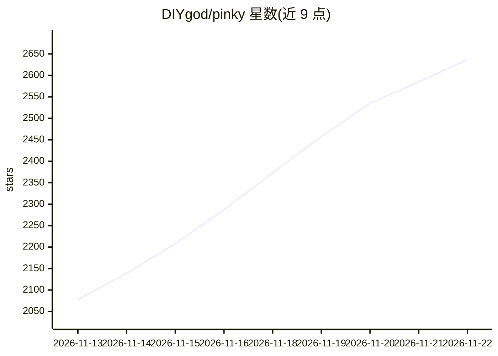

# DIYgod/pinky

⭐ 2,637 · Go · Apache-2.0 · 推送 2026-11-21 · [GitHub](https://github.com/DIYgod/pinky) · 个人维护 · 中文 README

**让 AI agent 经人审批操控真机 iPhone/Android 的 MCP 网关**

桌面端应用（macOS/Windows/Linux），通过 MCP 让 Claude Code、Codex、Cursor 等任意 agent 操控真实的 Android（10-17）或 iPhone（iOS 17.4+）手机，用户在电脑上镜像观看、审批风险步骤、随时接管；手机端 App 也可脱离电脑自主执行任务，可选 DeepSeek、Qwen、Kimi、Claude、GPT、Ollama 等模型。审批由 Pinky 网关强制执行，银行/钱包/密码类应用默认不可见，每次运行有截图、录屏与 HTML 报告。自带 adb，安装包约 16-22MB，非 Electron。自述为 pre-alpha 阶段。

## 筛选速览

| 维度 | 判定 | 备注 |
|---|---|---|
| AI 角色 | `ai-ecosystem` | LLM/agent 周边工具 |
| 许可风险 | `permissive` | Apache-2.0 |
| 部署形态 | `desktop` | 安装包/桌面程序 |
| 模型依赖 | local-ok | 支持本地模型 |
| 硬件要求 | — | 无带数字的原话,不猜 |
| 安装摩擦 | `high` | 编译与系统依赖俱全 |
| 成熟度 | `idea` | |

## 能力要点

- 任意 MCP agent 操控真机，网关强制人工审批风险步骤
- 手机端 App 可无电脑自主执行任务，支持 DeepSeek/Qwen/Kimi/GLM/Claude/GPT/Gemini 及 Ollama/LM Studio 本地模型
- 每次运行留存分步记录、截图、录屏与可导出 HTML 报告
- 银行/钱包/密码应用默认对 agent 不可见，Android 13+ 在隐藏第二屏执行

## 适用场景

- 让 Claude Code 等 agent 在我的手机上完成操作，风险步骤由我点击放行
- 不在电脑旁时用手机 App 直接派任务给 AI
- 回看 agent 每一步的录屏与报告，审计它做了什么

## 场景标签

`GUI 自动化` · 领域:效率与自动化

## 证据(README 行号)

> L7: Pinky lets any agent (Claude Code, Claude Desktop, Codex, Cursor or a script) operate a real iPhone or Android phone
> L11: - **Any agent, one click.** Settings › Agents connects Claude Code, Claude Desktop, Codex, Cursor and more, and any
> L12: - **Pinky on the phone, no computer needed.** Pinky's app on Android and iPhone does tasks by itself with a model y

## 星数曲线

2026-11-13 2,078 → 2026-11-22 2,637（+559）

---
*卡片 v1 · prompt 1.4 · 生成 2026-11-17 · 置信度 high · 依据 README sha `efcfb6ef9ff7` · [字段定义](../../DATASET.md)*
