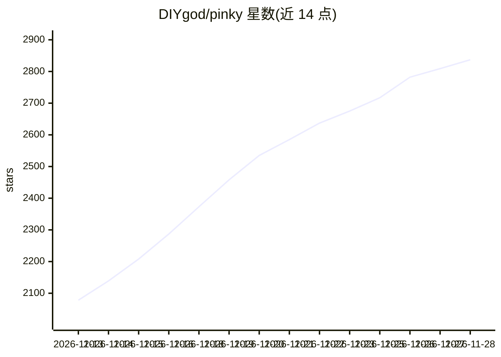

# DIYgod/pinky

⭐ 2,837 · Go · Apache-2.0 · 推送 2026-11-27 · [GitHub](https://github.com/DIYgod/pinky) · 个人维护

**让人审核下 AI 经 MCP 操控 iPhone/Android 手机**

Pinky 是一个桌面与手机端应用：把 iPhone 或 Android 手机通过 MCP 暴露给任意 agent（Claude Code、Claude Desktop、Codex、Cursor 等），用户在电脑上观看屏幕、批准风险步骤、随时接管并查看带截图与录屏的操作记录。审批规则由 Pinky 的网关强制执行，银行/钱包/密码管理类应用默认对 agent 不可见。手机端 App 亦可独立用用户选择的模型执行任务。当前状态为 pre-alpha，提供 macOS（dmg/brew）、Windows（exe）、Linux（deb/tar.gz）安装包。

## 筛选速览

| 维度 | 判定 | 备注 |
|---|---|---|
| AI 角色 | `ai-ecosystem` | LLM/agent 周边工具 |
| 许可风险 | `permissive` | Apache-2.0 |
| 部署形态 | `desktop` | 安装包/桌面程序 |
| 模型依赖 | local-ok | 支持本地模型 |
| 硬件要求 | — | 无带数字的原话,不猜 |
| 安装摩擦 | `high` | 编译与系统依赖俱全 |
| 成熟度 | `idea` | |

## 能力要点

- 经 MCP 让任意 agent 操控真实手机，网关强制人工审批风险操作
- 支持 Android 10-17 与 iOS 16+，含隐藏第二屏、远程解锁与定时任务
- 手机端 App 可脱离电脑独立运行，可选 DeepSeek/Qwen/Kimi/GLM/Claude/GPT/Gemini/Ollama 等模型
- 每步留文字、截图与带标记录屏，可导出 HTML 报告

## 适用场景

- 让 Claude Code 等 agent 代为操作手机完成日常任务
- 支付、发消息等敏感操作前逐条人工批准
- 在电脑上回看 agent 操作手机的完整记录

## 场景标签

`GUI 自动化` · 领域:效率与自动化

## 证据(README 行号)

> L7: Pinky lets any agent (Claude Code, Claude Desktop, Codex, Cursor or a script) operate a real iPhone or Android phone
> L11: - **Any agent, one click.** Settings › Agents connects Claude Code, Claude Desktop, Codex, Cursor and more, and any
> L26: **Status:** pre-alpha. Claude Code has used real phones through it end to end (an Android phone over USB, an iPhone

## 星数曲线

2026-11-13 2,078 → 2026-11-28 2,837（+759）

---
*卡片 v1 · prompt 1.4 · 生成 2026-11-28 · 置信度 high · 依据 README sha `b0c2adab57eb` · [字段定义](../../DATASET.md)*
