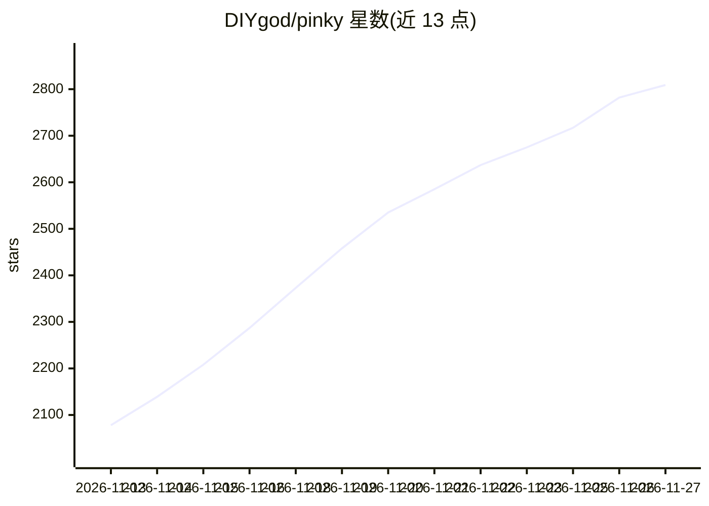

# DIYgod/pinky

⭐ 2,809 · Go · Apache-2.0 · 推送 2026-11-26 · [GitHub](https://github.com/DIYgod/pinky) · 个人维护 · 中文 README

**让 MCP agent 受控操作 iPhone/Android 手机的桌面网关**

Pinky 是一个跨平台桌面应用，通过 MCP 让任意 agent（Claude Code、Claude Desktop、Codex、Cursor 等）操作真实的 iPhone 或 Android 手机：用户在电脑上观看屏幕镜像、批准风险步骤、随时接管，并留下带截图与录屏的操作记录。审批规则运行在 Pinky 的网关中而非 agent 指令层，银行/钱包类应用默认对 agent 不可见。手机端 App 也可独立用所选模型执行任务。当前状态为 pre-alpha，支持 Android 10-17 与 iOS 17.4+。

## 筛选速览

| 维度 | 判定 | 备注 |
|---|---|---|
| AI 角色 | `ai-ecosystem` | LLM/agent 周边工具 |
| 许可风险 | `permissive` | Apache-2.0 |
| 部署形态 | `desktop` | 安装包/桌面程序 |
| 模型依赖 | local-ok | 支持本地模型 |
| 硬件要求 | — | 无带数字的原话,不猜 |
| 安装摩擦 | `high` | 编译与系统依赖俱全 |
| 成熟度 | `idea` | |

## 能力要点

- 任意 MCP agent 可连接，审批由网关强制执行，agent 无法自我批准
- Android 13+ 提供隐藏第二屏幕，agent 操作不占用手机主屏
- 每步操作记录截图与标记录屏，可导出 HTML 报告
- 手机端 App 支持本地模型（Ollama/LM Studio）与云端模型独立执行任务

## 适用场景

- 让 Claude Code 等 agent 代为操作手机完成应用内任务
- 支付/转账/删除等敏感操作前人工点击批准
- 电脑上远程解锁并操控放在别处的手机

## 场景标签

`GUI 自动化` · 领域:效率与自动化

## 证据(README 行号)

> L7: Pinky lets any agent (Claude Code, Claude Desktop, Codex, Cursor or a script) operate a real iPhone or Android phone
> L11: - **Any agent, one click.** Settings › Agents connects Claude Code, Claude Desktop, Codex, Cursor and more, and any
> L42: |**Agent**|Any agent that can use MCP servers, such as Claude Code, Claude Desktop, Codex or Cursor|

## 星数曲线

2026-11-13 2,078 → 2026-11-27 2,809（+731）

---
*卡片 v1 · prompt 1.4 · 生成 2026-11-27 · 置信度 high · 依据 README sha `fa4927ee59e2` · [字段定义](../../DATASET.md)*
