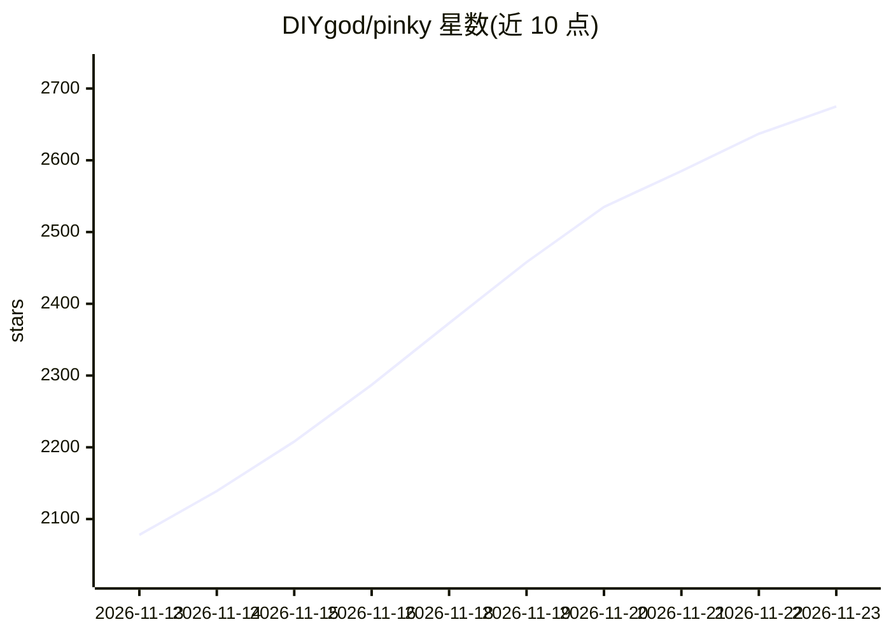

# DIYgod/pinky

⭐ 2,675 · Go · Apache-2.0 · 推送 2026-11-22 · [GitHub](https://github.com/DIYgod/pinky) · 个人维护

**让 AI agent 在你监督下操作 iPhone/Android 手机**

桌面应用与手机端 App：通过 MCP 让任意 agent（Claude Code、Codex、Cursor 或脚本）操作真实手机，同时用户可在电脑上查看、批准风险步骤、随时接管。审批由 Pinky 网关强制执行，支付等操作默认等待确认；银行/钱包应用默认不可见。手机端 App 可脱离电脑独立用所选模型执行任务。提供 macOS/Windows/Linux 安装包，状态为 pre-alpha。

## 筛选速览

| 维度 | 判定 | 备注 |
|---|---|---|
| AI 角色 | `ai-native` | 本体是模型或模型工具 |
| 许可风险 | `permissive` | Apache-2.0 |
| 部署形态 | `desktop` | 安装包/桌面程序 |
| 模型依赖 | local-ok | 支持本地模型 |
| 硬件要求 | — | 无带数字的原话,不猜 |
| 安装摩擦 | `high` | 编译与系统依赖俱全 |
| 成熟度 | `idea` | |

## 能力要点

- 任意支持 MCP 的 agent 可接入，网关强制审批而非靠提示词约束
- Android 13+ 提供隐藏第二屏幕，手机主屏仍归用户
- 每步记录文字、截图与带标记的录屏，可导出 HTML 报告
- 支持定时任务与经用户确认的记忆笔记

## 适用场景

- 让 Claude Code 等 agent 代为操作手机完成任务
- 支付/发消息等敏感操作需人工点击批准的场景
- 无电脑时用手机端 App 直接下达任务

## 场景标签

`GUI 自动化` · 领域:效率与自动化

## 证据(README 行号)

> L2:  Let AI use your iPhone or Android phone, with you in the loop: any agent from macOS, Windows or Linux, or Pinky its
> L7: Pinky lets any agent (Claude Code, Claude Desktop, Codex, Cursor or a script) operate a real iPhone or Android phone
> L26: **Status:** pre-alpha. Claude Code has used real phones through it end to end (an Android phone over USB, an iPhone

## 星数曲线

2026-11-13 2,078 → 2026-11-23 2,675（+597）

---
*卡片 v1 · prompt 1.4 · 生成 2026-11-23 · 置信度 high · 依据 README sha `0919d165c691` · [字段定义](../../DATASET.md)*
