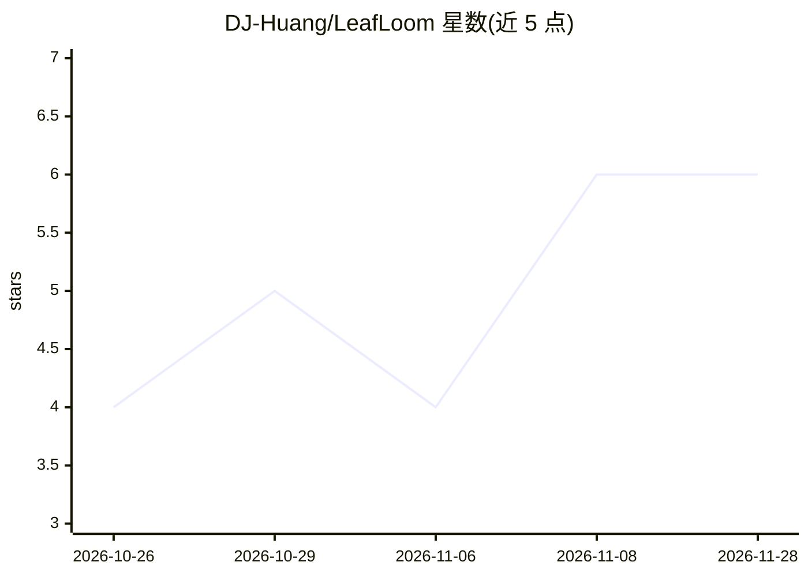

# DJ-Huang/LeafLoom

⭐ 6 · Python · MIT · 推送 2026-11-27 · [GitHub](https://github.com/DJ-Huang/LeafLoom) · [官网](https://dj-huang.github.io/LeafLoom/) · 个人维护 · 中文 README

**本地优先的 Markdown/HTML 知识库与个人 Wiki，可接入 AI**

开源、本地优先的知识管理工作区与个人 Wiki：文件与搜索索引留在本机，支持双向链接、知识图谱、模板与本地 HTML 预览。AI 部分全部为可选连接：通过内置 Tunnel 客户端在 ChatGPT 对话中检索/读写本地笔记，开放本地 MCP 端点（默认 127.0.0.1:18080）供 Codex/Cursor/Claude Code 等客户端接入，内置 $leafloom Skill，AI Chat 需另行安装 Codex 或 Codely CLI。语义检索依赖本地 BGE-M3，未准备模型时回退到关键词/Wiki 搜索。提供 Windows/Mac 安装包，无 Linux 版。

## 筛选速览

| 维度 | 判定 | 备注 |
|---|---|---|
| AI 角色 | `ai-enhanced` | 去掉 AI 部分产品仍成立 |
| 许可风险 | `permissive` | MIT |
| 部署形态 | `desktop` | 安装包/桌面程序 |
| 模型依赖 | — | README 未给出锁定关系 |
| 硬件要求 | — | 无带数字的原话,不猜 |
| 安装摩擦 | `low` | 无编译、无系统依赖或容器化 |
| 成熟度 | `idea` | |

## 能力要点

- 本地优先：文件与索引留在本机，无托管知识库也可离线浏览编辑
- ChatGPT 集成：内置 Tunnel 客户端，可在对话中检索并回链来源笔记
- 本地 HTTP MCP 端点与 $leafloom Skill，支持外部 AI 客户端读写笔记
- 可选本地 BGE-M3 语义检索，回退关键词/Wiki 搜索

## 适用场景

- 把散落的笔记、项目文档、网页收藏整理成带双链的个人 Wiki
- 在 ChatGPT 对话中检索并引用自己电脑上的笔记
- 让 Codex/Cursor/Claude Code 等 MCP 客户端读写本地知识库
- 在工作区内直接预览和运行本地 HTML 项目

## 场景标签

`知识库管理` `知识图谱` · 领域:知识与检索

## 证据(README 行号)

> L15: Turn scattered notes, project docs and saved webpages into a connected knowledge base. **LeafLoom is an open-source
> L38: |**AI in your workflow**|Connect MCP clients, install the bundled `$leafloom` Skill, or use AI Chat beside your not
> L48: - **AI connections are optional.** AI Chat may send your question, selected text, enabled note context and retrieve

## 星数曲线

2026-10-26 4 → 2026-11-28 6（+2）

---
*卡片 v1 · prompt 1.4 · 生成 2026-11-20 · 置信度 high · 依据 README sha `43b609482ddd` · [字段定义](../../DATASET.md)*
