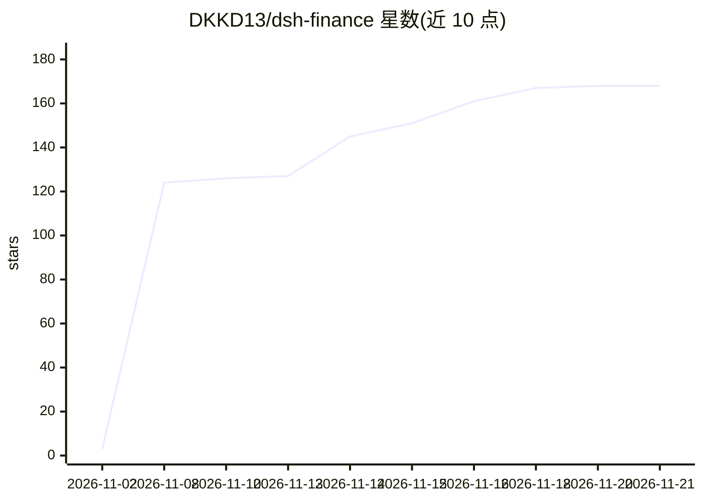

# DKKD13/dsh-finance

⭐ 168 · TypeScript · MIT · 推送 2026-11-05 · [GitHub](https://github.com/DKKD13/dsh-finance) · 个人维护 · 中文 README

**给 DeepSeek Harness 用户的金融研究插件：Skills、资料库与模拟基金**

DKKD13 个人开发的第三方 DeepSeek Harness 插件，与 DeepSeek 官方无隶属关系。在 DSH 工作台中提供 38 个研究 Skills（公司研究、估值、每日简报等）、证据资料库（PDF/DOCX/Markdown 导入、网页剪藏、AI 摘要与原文高亮）、个股图表（Yahoo 报价显式请求读取）与纸面模拟基金（多角色研究工位、净值账本）。复用 Harness 的模型与原生对话，不附带模型密钥；数据默认写入本地 graph.json。当前为 0.1.0 预览版，要求 DSH >=0.2.1-rc.1 <0.3.0。虚拟基金不连接券商、不执行真实交易。

## 筛选速览

| 维度 | 判定 | 备注 |
|---|---|---|
| AI 角色 | `ai-ecosystem` | LLM/agent 周边工具 |
| 许可风险 | `permissive` | MIT |
| 部署形态 | `library` | 以包/库形式分发 |
| 模型依赖 | locked-api |  |
| 硬件要求 | — | 无带数字的原话,不猜 |
| 安装摩擦 | `low` | 无编译、无系统依赖或容器化 |
| 成熟度 | `idea` | |

## 能力要点

- 38 个可注册研究 Skills（公司研究/估值/每日简报/假说论证等）
- 证据资料库：原文高亮、AI 摘要、来源时间保留、网页剪藏与多格式导入
- 纸面模拟基金：多角色研究工位与统一账本的净值历史
- 数据默认本地保存（~/.dsh-research-graph/graph.json），无需额外数据库

## 适用场景

- 在 DSH 中带材料做有出处的公司研究与估值
- 在资料库中阅读、核对并关联研究材料与观点
- 用纸面模拟基金记录多空判断与净值历史

## 场景标签

`金融量化` `科研工具` `知识库管理` · 领域:知识与检索

## 证据(README 行号)

> L4:  An independent personal plugin for DeepSeek Harness.
> L8: DSH Finance 把市场、研究 Skills、资料、观点和模拟基金放进同一个 DeepSeek Harness 工作台。选一个研究任务，带着材料进入对话；读结论时，随时回到原文，继续追问。
> L54: 需要已安装的 **DeepSeek Harness `>=0.2.1-rc.1 <0.3.0`**，以及可用的模型配置。插件复用 Harness 的模型和原生对话，不附带模型密钥。

## 星数曲线

2026-11-02 3 → 2026-11-21 168（+165）

---
*卡片 v1 · prompt 1.4 · 生成 2026-11-17 · 置信度 high · 依据 README sha `77cbe929173f` · [字段定义](../../DATASET.md)*
