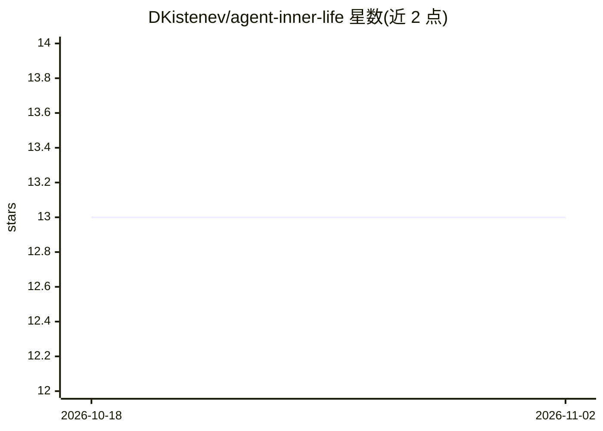

# DKistenev/agent-inner-life

⭐ 13 · MIT · 推送 2026-08-21 · [GitHub](https://github.com/DKistenev/agent-inner-life) · [官网](https://github.com/DKistenev/hermes-inner-life) · 个人维护

**给 AI agent 添加带日期状态、晚间日志与夜间自由思考的技能**

以 Markdown 技能形式交付的 agent 扩展：为已有记忆与调度能力的 agent 增加三种写入——state.md 记录带日期的单行事实、每日晚间日志条目、夜间静默时段的自由思考（dreams），并在原生记忆中保留每晚重写的两三行摘要，注入后续每个会话。其余内容均保持本地，仅在运行打开或被询问时读取；晚间与夜间任务由用户自建 cron 触发，技能本身不后台运行。明确声明不与运行时既有记忆、自改进技能、调度器竞争，且刻意不使用任何数值评分。安装面向 Hermes Agent 与 OpenClaw，其他可加载技能的运行时可通过复制目录或原始 URL 接入。

## 筛选速览

| 维度 | 判定 | 备注 |
|---|---|---|
| AI 角色 | `ai-ecosystem` | LLM/agent 周边工具 |
| 许可风险 | `permissive` | MIT |
| 部署形态 | `None` |  |
| 模型依赖 | — | README 未给出锁定关系 |
| 硬件要求 | — | 无带数字的原话,不猜 |
| 安装摩擦 | `low` | 无编译、无系统依赖或容器化 |
| 成熟度 | — | 结构信号不足 |

## 能力要点

- 三种写入物：state.md 带日期事实、每日日志、夜间自由思考（dreams）
- 原生记忆中的短摘要会注入后续所有会话，其余记录仅在打开或被问时读取
- 无后台钩子，晚间/夜间例程由用户创建的 cron 任务驱动
- 刻意不含任何数值评分，以日期承载时间衰减

## 适用场景

- 让长期运行的 agent 回答“最近进展如何”这类需要跨会话记录的问题
- 为 agent 建立晚间日志与周期性汇总的工作节奏
- 在静默时段让 agent 记录与数据无关的自由思考

## 场景标签

`Agent 记忆` · 领域:Agent 开发

## 证据(README 行号)

> L5: An agent skill that gives an agent dated state, an evening journal, free thinking at night, and a way to read all of
> L48: Nothing here is tied to a particular runtime. The skill is markdown — one `SKILL.md`, four references, one template

## 星数曲线

2026-10-18 13 → 2026-11-02 13（+0）

---
*卡片 v1 · prompt 1.4 · 生成 2026-10-31 · 置信度 high · 依据 README sha `961109c137d7` · [字段定义](../../DATASET.md)*
