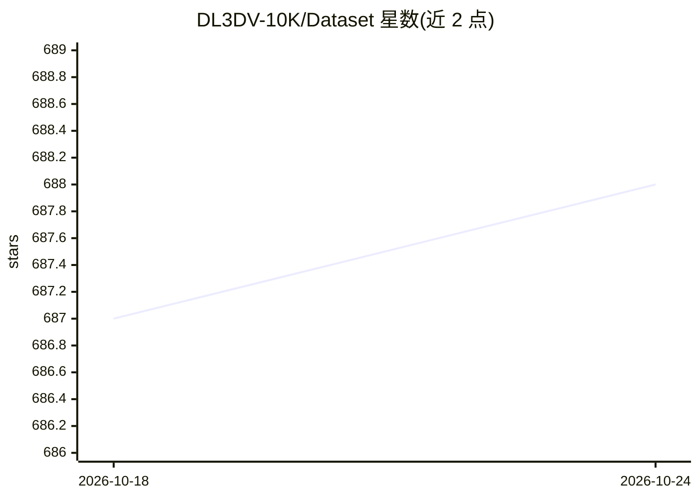

# DL3DV-10K/Dataset

⭐ 688 · HTML · NOASSERTION · 推送 2026-02-10 · [GitHub](https://github.com/DL3DV-10K/Dataset) · [官网](https://dl3dv-10k.github.io/DL3DV-10K/) · 组织维护

**面向 3D 视觉研究的大规模真实场景数据集（10,510 场景）**

学生主导的大规模场景级数据集：10,510 个多视角视频、5,120 万帧 4K 分辨率画面，覆盖 65 类兴趣点位置的有界/无界场景，附场景标注（室内外、反射/透明/光照）与 COLMAP 相机位姿。提供 140 场景 NVS 基准及 3DGS、Zip-NeRF、Mip-NeRF 360、Instant-NGP、Nerfacto 训练结果。通过 Hugging Face 按访问申请分发 480P~4K 多版本，配套 download.py 子集下载脚本；数据约定遵循 NeRFStudio。

## 筛选速览

| 维度 | 判定 | 备注 |
|---|---|---|
| AI 角色 | `ai-knowledge` | 知识聚合/清单类 |
| 许可风险 | `none` | NOASSERTION |
| 部署形态 | `library` | 以包/库形式分发 |
| 模型依赖 | — | README 未给出锁定关系 |
| 硬件要求 | — | 无带数字的原话,不猜 |
| 安装摩擦 | `low` | 无编译、无系统依赖或容器化 |
| 成熟度 | — | 结构信号不足 |

## 能力要点

- 10,510 场景 / 5,120 万帧 4K 分辨率多视角数据
- 场景级标注（室内外、反射、透明、光照）与 COLMAP 位姿
- 140 场景 NVS 基准与多方法训练参数
- 多分辨率版本（480P~4K）与子集下载脚本

## 适用场景

- 新视角合成（NVS）方法训练与基准评测
- 学习泛化 NeRF / 3D 表征的基础数据
- 3D 重建/3DGS 研究的数据准备

## 场景标签

 · 领域:3D 视觉/计算机视觉数据

## 证据(README 行号)

> L3: **DL3DV-10K is a dataset of real-world videos with scene annotations and camera parameters.**
> L25: We have witnessed significant progress in deep learning-based 3D vision, ranging from neural radiance field (NeRF) 

## 星数曲线

2026-10-18 687 → 2026-10-24 688（+1）

---
*卡片 v1 · prompt 1.4 · 生成 2026-10-21 · 置信度 mid · 依据 README sha `0efed5ee145a` · [字段定义](../../DATASET.md)*
