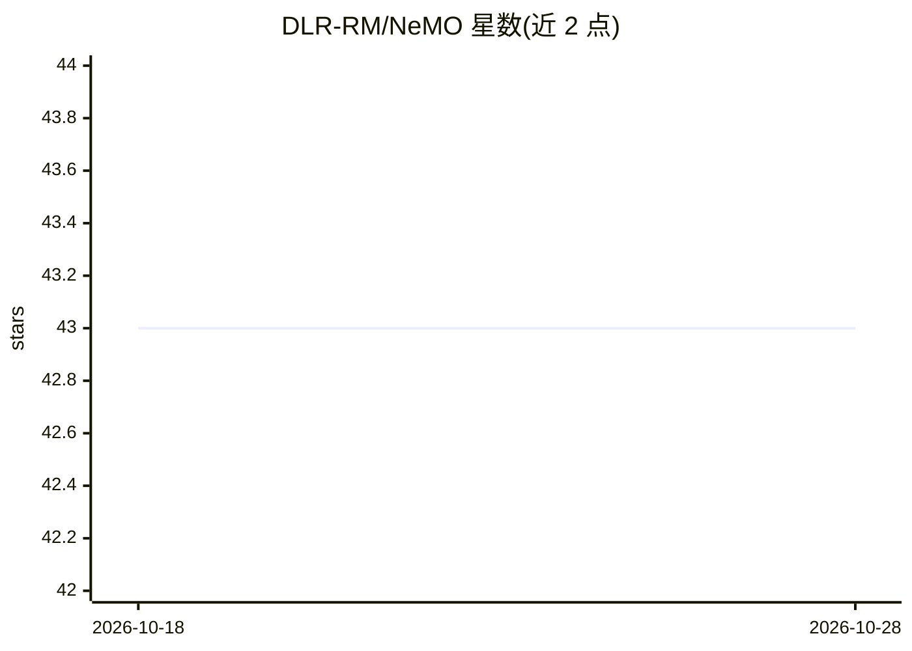

# DLR-RM/NeMO

⭐ 43 · Python · MIT · 推送 2026-07-21 · [GitHub](https://github.com/DLR-RM/NeMO) · [官网](https://sebastian-jung.github.io/nemo/) · 组织维护

**少样本感知研究库：从图像生成神经记忆对象做分割/检测/6DoF位姿估计**

论文 Finding NeMO（3DV 2026）的官方 PyTorch 实现，由德国航空航天中心（DLR）机器人与机电一体化研究所团队维护。以 nemolib Python 包形式提供：从图像生成 Neural Memory Objects，并用于少样本场景下的分割、检测与 6DoF 位姿估计。安装需 Python>=3.9，建议使用 conda 或 uv，从源码克隆构建，需拼接分片式 checkpoint 后运行示例推理脚本；代码借用了 LEAP 与 Dust3r 的部分实现。

## 筛选速览

| 维度 | 判定 | 备注 |
|---|---|---|
| AI 角色 | `ai-native` | 本体是模型或模型工具 |
| 许可风险 | `permissive` | MIT |
| 部署形态 | `None` |  |
| 模型依赖 | — | README 未给出锁定关系 |
| 硬件要求 | — | 无带数字的原话,不猜 |
| 安装摩擦 | `low` | 无编译、无系统依赖或容器化 |
| 成熟度 | — | 结构信号不足 |

## 能力要点

- 从图像生成 Neural Memory Objects（模板视图的几何感知表示）
- 支持少样本分割、检测与 6DoF 位姿估计
- 以 nemolib Python 包提供，附 demo 与示例脚本

## 适用场景

- 机器人感知中基于少量模板图像的物体分割与位姿估计
- 复现或扩展 Finding NeMO 论文方法
- 使用预训练 checkpoint 对示例物体（mug、coffee_machine）运行推理

## 场景标签

`目标检测` `科研工具` · 领域:学习与行业

## 证据(README 行号)

> L13: Official pytorch implementation of the paper **Finding NeMO: A Geometry-Aware Representation of Template Views for 
> L15: This repository contains code for the `nemolib` package, an easy-to-use python package to generate Neural Memory Ob

## 星数曲线

2026-10-18 43 → 2026-10-28 43（+0）

---
*卡片 v1 · prompt 1.4 · 生成 2026-10-25 · 置信度 high · 依据 README sha `b72dc8e42115` · [字段定义](../../DATASET.md)*
