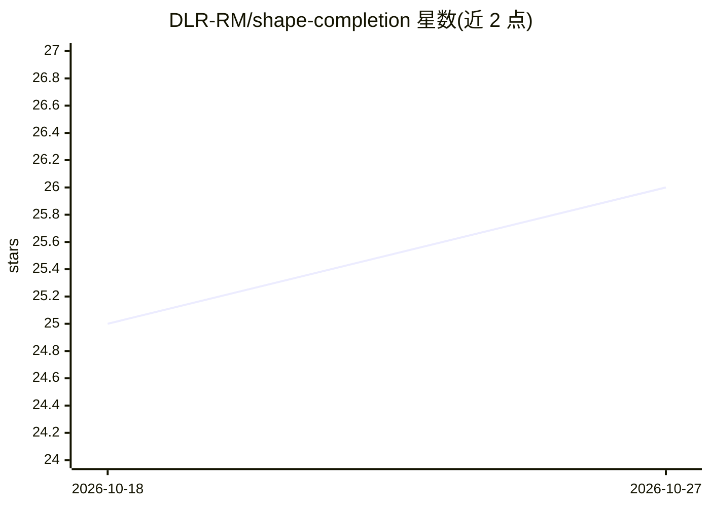

# DLR-RM/shape-completion

⭐ 26 · Python · MIT · 推送 2026-08-14 · [GitHub](https://github.com/DLR-RM/shape-completion) · [官网](https://dlr-rm.github.io/shape-completion) · 组织维护

**面向研究者的 3D 形状补全研究平台，实现 30+ 种深度学习架构**

德国宇航院机器人力学所（DLR-RM）维护的模块化 3D 形状补全研究平台，覆盖隐式函数、点云补全、扩散模型、Transformer、自编码器等 30+ 架构，支持点云、深度图、RGB-D、模拟 Kinect 等输入模态。基于 PyTorch Lightning 提供分布式训练（SLURM/DDP），内置 Chamfer/EMD/F1/IoU/FID 评测与多后端渲染，并附三篇论文（IROS 2023、Humanoids 2023、3DV 2026）的复现配置与数据集。安装经 uv/pip 加分层编译 C++/CUDA 自定义库完成。

## 筛选速览

| 维度 | 判定 | 备注 |
|---|---|---|
| AI 角色 | `ai-native` | 本体是模型或模型工具 |
| 许可风险 | `permissive` | MIT |
| 部署形态 | `library` | 以包/库形式分发 |
| 模型依赖 | — | README 未给出锁定关系 |
| 硬件要求 | — | 无带数字的原话,不猜 |
| 安装摩擦 | `medium` | 含编译或系统依赖之一 |
| 成熟度 | — | 结构信号不足 |

## 能力要点

- 30+ 模型架构（ONet、ConvONet、IF-Net、PCN、SnowflakeNet、扩散模型等）
- 多种输入模态：点云、深度图、RGB-D、模拟 Kinect
- PyTorch Lightning 分布式训练（SLURM/DDP）与 55+ 数据变换
- 提供三篇已发表论文的复现配置、数据集与脚本

## 适用场景

- 研究者复现或对比 3D 形状补全论文结果
- 机器人为抓取预测做物体形状补全
- 训练与评测隐式/点云/扩散类形状补全模型

## 场景标签

`模型训练` · 领域:训练与推理

## 证据(README 行号)

> L3: A modular research platform for 3D shape completion using deep learning. Implements 30+ architectures spanning impli
> L18: - **30+ Model Architectures**: ONet, ConvONet, IF-Net, PCN, SnowflakeNet, ShapeFormer, diffusion models, VAE/VQ-VAE

## 星数曲线

2026-10-18 25 → 2026-10-27 26（+1）

---
*卡片 v1 · prompt 1.4 · 生成 2026-10-27 · 置信度 mid · 依据 README sha `c848a767a92a` · [字段定义](../../DATASET.md)*
