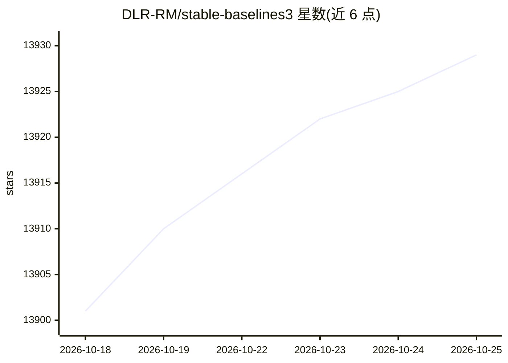

# DLR-RM/stable-baselines3

⭐ 13,929 · Python · MIT · 推送 2026-10-13 · [GitHub](https://github.com/DLR-RM/stable-baselines3) · [官网](https://stable-baselines3.readthedocs.io) · 组织维护

**给 RL 研究者与工程师提供 PyTorch 强化学习算法参考实现库**

基于 PyTorch 的强化学习算法实现集合（Stable Baselines 的后续主要版本），提供 A2C、PPO、DQN、SAC、TD3 等算法的统一接口，支持自定义环境与自定义策略、Dict 观测空间、Tensorboard 日志与回调机制。代码遵循 sklearn 风格语法。面向研究社区与工业界，用于复现、对比与新想法验证；README 提示使用者需具备一定 RL 基础。核心仓库目前聚焦于 bug 修复与维护，新算法在 SB3-Contrib、SBX 等关联仓库中开发。

## 筛选速览

| 维度 | 判定 | 备注 |
|---|---|---|
| AI 角色 | `ai-ecosystem` | LLM/agent 周边工具 |
| 许可风险 | `permissive` | MIT |
| 部署形态 | `library` | 以包/库形式分发 |
| 模型依赖 | — | README 未给出锁定关系 |
| 硬件要求 | — | 无带数字的原话,不猜 |
| 安装摩擦 | `low` | 无编译、无系统依赖或容器化 |
| 成熟度 | — | 结构信号不足 |

## 动量与使用信号

- 维护:`active` — 距上次 push 4.7 天,年发版 3,163 位贡献者
- 涨星:近 1 天 **+2**(自 20261016 起算)
- 安装:pypi 包 `stable-baselines3` 月下载 706,843

## 能力要点

- 提供 A2C、PPO、DQN、SAC、TD3 等多种强化学习算法的统一接口实现
- 支持自定义环境、自定义策略、Dict 观测空间与多进程训练
- 与 Weights & Biases、Hugging Face 存在文档记载的集成
- 提供 Google Colab 在线运行示例与配套训练框架 RL Baselines3 Zoo

## 适用场景

- 训练和评估自定义 Gymnasium 环境上的强化学习智能体
- 作为基线实现，将新提出的 RL 算法与已有方法做对比
- 复用常见环境的调优超参数快速训练模型

## 场景标签

`强化学习` · 领域:训练与推理

## 证据(README 行号)

> L7: Stable Baselines3 (SB3) is a set of reliable implementations of reinforcement learning algorithms in PyTorch. It is 
> L11: These algorithms will make it easier for the research community and industry to replicate, refine, and identify new
> L94: **Note:** Stable-Baselines3 supports PyTorch >= 2.8

## 星数曲线

2026-10-18 13,901 → 2026-10-25 13,929（+28）

---
*卡片 v1 · prompt 1.4 · 生成 2026-10-18 · 置信度 high · 依据 README sha `ab35425ecc0c` · [字段定义](../../DATASET.md)*
