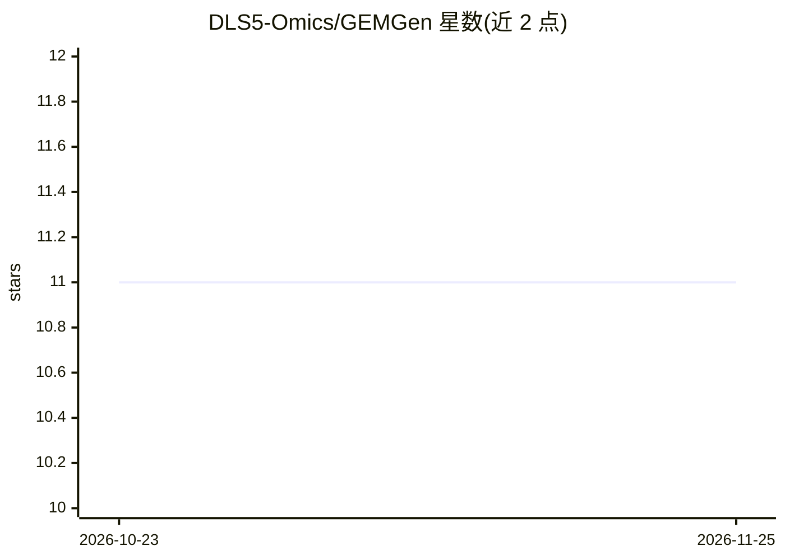

# DLS5-Omics/GEMGen

⭐ 11 · Python · Apache-2.0 · 推送 2026-09-01 · [GitHub](https://github.com/DLS5-Omics/GEMGen) · 组织维护

**基于LLM的化学扰动逆向设计框架：生成目标细胞态转换的候选分子**

GEMGen（Gene Expression-guided Molecular Generator）面向扰动生物学的逆向设计问题：输入表示初始与目标细胞状态的转录组差异基因列表，以文本化的指令格式条件化一个指令微调的自回归 LLM，直接生成候选小分子（SMILES），不限于预定义化合物库。框架含生成器、合法性/成药性过滤器和分子-转录响应评分器三个组件，支持化学扰动、遗传扰动（如 CRISPRi）签名等不同生物场景。依赖 Conda 与 vllm 推理，需从 Zenodo 下载预训练检查点。

## 筛选速览

| 维度 | 判定 | 备注 |
|---|---|---|
| AI 角色 | `ai-native` | 本体是模型或模型工具 |
| 许可风险 | `permissive` | Apache-2.0 |
| 部署形态 | `library` | 以包/库形式分发 |
| 模型依赖 | local-ok | 支持本地模型 |
| 硬件要求 | — | 无带数字的原话,不猜 |
| 安装摩擦 | `medium` | 含编译或系统依赖之一 |
| 成熟度 | — | 结构信号不足 |

## 能力要点

- 指令微调 LLM 按转录组状态转换自回归生成 SMILES 分子
- 过滤与评分两级筛选（QED/Lipinski 合成可及性 + 扰动响应匹配分数）
- 支持化学扰动与遗传扰动（CRISPRi）签名等多种场景
- bioRxiv 预印本与 Zenodo 检查点公开可下载

## 适用场景

- 给定疾病相关转录组签名，生成候选小分子供实验验证
- 在 CRISPRi 等遗传扰动数据上扩展生成场景
- 药物重定位候选分子的计算筛选与排序

## 场景标签

 · 领域:生命科学/AI 药物发现

## 证据(README 行号)

> L3: **GEMGen** (Gene Expression-guided Molecular Generator) is a large language model-based framework for the **inverse 
> L9: - **Generator**: an instruction-tuned LLM that generates molecular candidates (SMILES) autoregressively, conditioned

## 星数曲线

2026-10-23 11 → 2026-11-25 11（+0）

---
*卡片 v1 · prompt 1.4 · 生成 2026-11-19 · 置信度 high · 依据 README sha `4ece90538b9c` · [字段定义](../../DATASET.md)*
