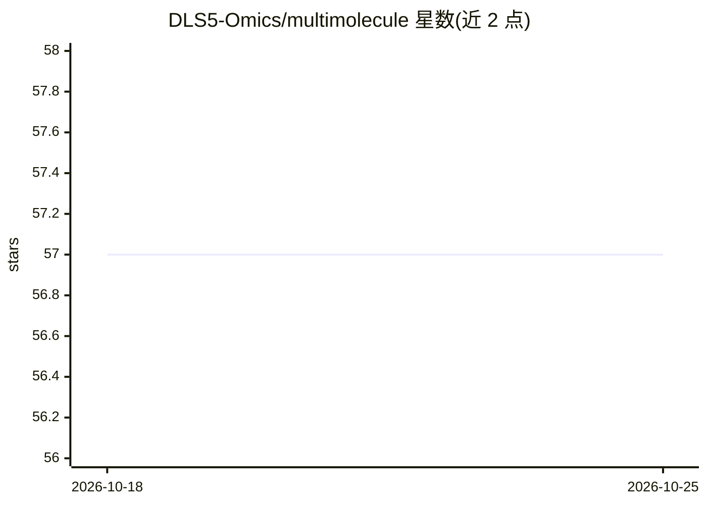

# DLS5-Omics/multimolecule

⭐ 57 · Python · AGPL-3.0 · 推送 2026-10-24 · [GitHub](https://github.com/DLS5-Omics/multimolecule) · [官网](https://multimolecule.danling.org/) · 组织维护

**分子机器学习一站式生态系统，覆盖 RNA/DNA/蛋白质任务**

面向分子生物学研究者的 Python 机器学习生态系统：连接 curated 数据集、模型实现、可复用的数据集与神经网络模块、基于 DanLing 的训练评估 runner，以及面向 RNA、DNA、蛋白质工作流的任务式推理管线。通过 Hugging Face transformers 接口注册模型与 pipeline，可直接运行 RNA 二级结构预测等任务；也支持 AutoModelForSequencePrediction 低层加载。提供 FASTA/DBN/BPSEQ/bpRNA 格式读写与 DNA/RNA/蛋白质/点括号 tokeniser。以 AGPL v3 许可发布，从 PyPI 安装。

## 筛选速览

| 维度 | 判定 | 备注 |
|---|---|---|
| AI 角色 | `ai-native` | 本体是模型或模型工具 |
| 许可风险 | `viral` | AGPL-3.0 |
| 部署形态 | `library` | 以包/库形式分发 |
| 模型依赖 | — | README 未给出锁定关系 |
| 硬件要求 | — | 无带数字的原话,不猜 |
| 安装摩擦 | `low` | 无编译、无系统依赖或容器化 |
| 成熟度 | — | 结构信号不足 |

## 能力要点

- 收录 curated 生物分子数据集与任务元数据
- 经 Hugging Face transformers 注册模型与推理 pipeline
- DNA/RNA/蛋白质与 dot-bracket tokeniser，及 FASTA/DBN/BPSEQ/bpRNA 读写
- 基于 DanLing 的训练、评估与推理 runner

## 适用场景

- 用预置 pipeline 运行 RNA 二级结构等生物任务推理
- 训练和评估 RNA/DNA/蛋白质机器学习模型
- 在我的生物序列建模项目中复用数据加载与神经网络模块

## 场景标签

`科研工具` · 领域:学习与行业

## 证据(README 行号)

> L18: MultiMolecule is a one-stop ecosystem for molecular machine learning.
> L19: It connects datasets, model implementations, reusable dataset and neural-network modules, the DanLing-based runner 
> L35: predictor = pipeline("rna-secondary-structure", model="multimolecule/ernierna-ss")

## 星数曲线

2026-10-18 57 → 2026-10-25 57（+0）

---
*卡片 v1 · prompt 1.4 · 生成 2026-10-24 · 置信度 high · 依据 README sha `5f3fc66f4897` · [字段定义](../../DATASET.md)*
