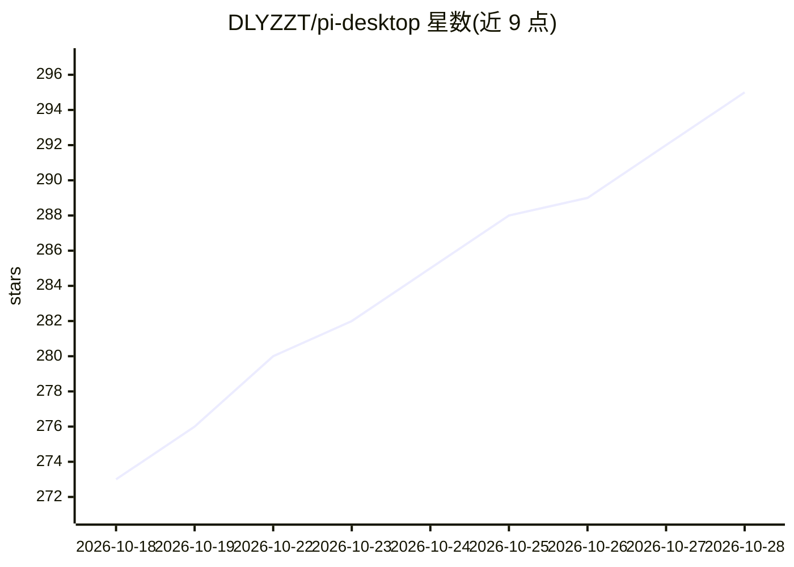

# DLYZZT/pi-desktop

⭐ 295 · TypeScript · Apache-2.0 · 推送 2026-10-23 · [GitHub](https://github.com/DLYZZT/pi-desktop) · [官网](https://pi-desktop.app) · 个人维护 · 中文 README

**给 Pi Coding Agent 用户的本地优先跨平台桌面工作台**

基于 Electron 43 / React 19 的桌面应用，把 Pi Coding Agent 包装成图形工作台：会话管理与流式回复、用户/Agent 共享的内置 Chromium 浏览器、MCP 服务接入与 OAuth 登录、受管开发进程（Vite/Flask 等）、Git 分支与 Worktree 管理、Auto 模型自动路由、Skills/Plugins 管理，以及微信/Telegram/飞书消息渠道。数据留在本机 ~/.pi/agent/，无内部服务器，可与 Pi CLI 复用同一配置。提供 macOS/Windows/Linux 安装包，Apache-2.0。

## 筛选速览

| 维度 | 判定 | 备注 |
|---|---|---|
| AI 角色 | `ai-ecosystem` | LLM/agent 周边工具 |
| 许可风险 | `permissive` | Apache-2.0 |
| 部署形态 | `None` |  |
| 模型依赖 | — | README 未给出锁定关系 |
| 硬件要求 | — | 无带数字的原话,不猜 |
| 安装摩擦 | `low` | 无编译、无系统依赖或容器化 |
| 成熟度 | — | 结构信号不足 |

## 能力要点

- 用户与 Agent 共享的内置 Chromium 浏览器（多 Tab、Profile、独立授权）
- MCP 服务接入：stdio/Streamable HTTP、OAuth 登录与工具浏览
- Auto 虚拟模型按思考级别或决策模型自动路由
- 微信/Telegram/飞书消息渠道接入，外部对话独立 Pi Session

## 适用场景

- 在图形界面中管理 Pi Coding Agent 会话与项目文件
- 让 Agent 在内置浏览器中阅读和操作网页，用户可随时接管
- 通过微信/Telegram/飞书远程与 Agent 对话
- 在统一界面管理 MCP 服务、Skills 与 Plugins

## 场景标签

`编码 Agent` `浏览器自动化` · 领域:效率与自动化

## 证据(README 行号)

> L230: Pi Agent Desktop 使用 Electron 三进程模型，将高权限桌面能力、Agent 运行时和 UI 隔离开来。
> L240: - **Agent Host**：在独立 `utilityProcess` 中运行 Pi Coding Agent，处理会话、文件、配置与扩展
> L303: Pi Agent Desktop 是 Pi Coding Agent 的桌面工作台，继续使用 `~/.pi/agent/` 中的会话和配置，因此可以与 CLI 配合使用。

## 星数曲线

2026-10-18 273 → 2026-10-28 295（+22）

---
*卡片 v1 · prompt 1.4 · 生成 2026-10-22 · 置信度 mid · 依据 README sha `1589f9ee1f9c` · [字段定义](../../DATASET.md)*
