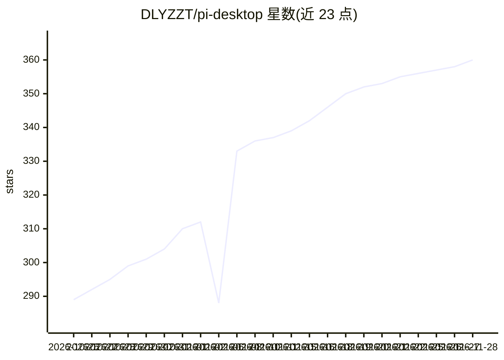

# DLYZZT/pi-desktop

⭐ 360 · TypeScript · Apache-2.0 · 推送 2026-11-24 · [GitHub](https://github.com/DLYZZT/pi-desktop) · [官网](https://pi-desktop.app) · 个人维护 · 中文 README

**把 Pi Coding Agent 变成桌面工作台的本地优先 Electron 应用**

面向 Pi Coding Agent 用户的跨平台桌面客户端：提供会话管理（流式回复、队列消息、执行历史树）、用户与 Agent 共享的内置 Chromium 浏览器、受管后台开发进程、MCP 服务配置、Git/Worktree 项目文件管理、技能与插件管理，以及 Auto 虚拟模型的快/强模型自动路由。支持微信、Telegram、飞书/Lark 消息渠道接入。普通用户经安装包使用无需单独装 Pi CLI 或 Node.js；受管进程与高级浏览器模式默认关闭，Windows ARM64 等平台不受支持。

## 筛选速览

| 维度 | 判定 | 备注 |
|---|---|---|
| AI 角色 | `ai-ecosystem` | LLM/agent 周边工具 |
| 许可风险 | `permissive` | Apache-2.0 |
| 部署形态 | `None` |  |
| 模型依赖 | — | README 未给出锁定关系 |
| 硬件要求 | — | 无带数字的原话,不猜 |
| 安装摩擦 | `low` | 无编译、无系统依赖或容器化 |
| 成熟度 | — | 结构信号不足 |

## 能力要点

- 用户与 Agent 共享同一 Chromium 页面的内置浏览器，带分级授权与私网保护
- Auto 虚拟模型按思考级别与问题复杂度在快/强模型间路由
- 受管后台进程支持 Vite/Spring Boot 等长驻服务，含执行树与日志脱敏
- 微信、Telegram、飞书/Lark 消息渠道与桌面会话并存

## 适用场景

- 在图形界面中管理 Pi Coding Agent 的多会话开发工作流
- 让 Agent 操作浏览器完成页面快照、截图与表单交互
- 通过微信/Telegram/飞书远程与本地 Agent 对话
- 统一管理模型凭据、MCP 服务、Skills 与 Plugins

## 场景标签

`编码 Agent` `浏览器自动化` · 领域:效率与自动化

## 证据(README 行号)

> L5: **把 Pi Coding Agent 变成真正的桌面工作台。**
> L240: - **Agent Host**：在独立 `utilityProcess` 中运行 Pi Coding Agent，处理会话、文件、配置与扩展
> L303: Pi Agent Desktop 是 Pi Coding Agent 的桌面工作台，继续使用 `~/.pi/agent/` 中的会话和配置，因此可以与 CLI 配合使用。

## 星数曲线

2026-10-26 289 → 2026-11-28 360（+71）

---
*卡片 v1 · prompt 1.4 · 生成 2026-11-27 · 置信度 mid · 依据 README sha `69211f518826` · [字段定义](../../DATASET.md)*
