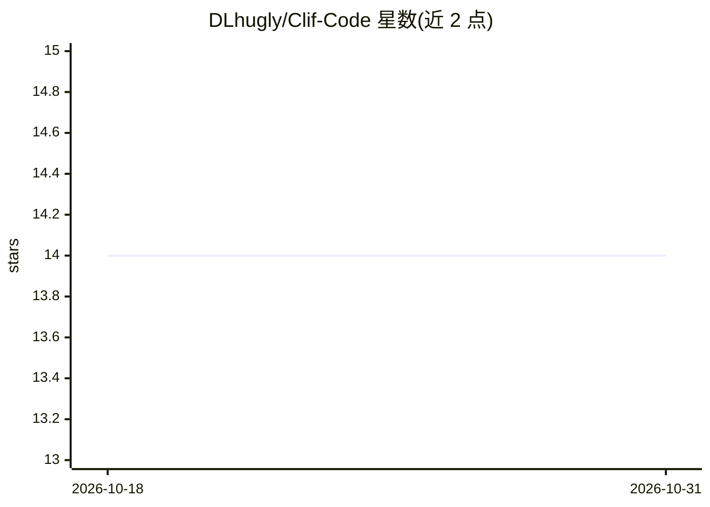

# DLhugly/Clif-Code

⭐ 14 · TypeScript · NOASSERTION · 推送 2026-07-16 · [GitHub](https://github.com/DLhugly/Clif-Code) · [官网](https://clifcode.io) · 个人维护

**Rust 原生轻量代码编辑器与终端 AI 编程 agent，接任意 LLM**

一个 monorepo 两个产品：ClifPad 是约 20MB 的 Rust 原生桌面 IDE（Tauri 2 + SolidJS + Monaco），含编辑器、原生 PTY 终端、Git 集成、带 9 工具调用的 AI agent 侧栏、20 套主题与提交前安全扫描；ClifCode 是纯 Rust 终端 AI agent，提供 9 个文件/命令工具、三级上下文压缩、3 种自主模式与会话持久化。两者均通过 OpenRouter、OpenAI、Anthropic 或 Ollama（完全本地）接入任意 LLM。桌面版提供 macOS/Windows/Linux 安装包，终端版经 cargo 或 npm 安装。许可为 FSL-1.1-ALv2，禁止构建竞争性商业产品，两年后转 Apache 2.0。

## 筛选速览

| 维度 | 判定 | 备注 |
|---|---|---|
| AI 角色 | `ai-native` | 本体是模型或模型工具 |
| 许可风险 | `none` | NOASSERTION |
| 部署形态 | `desktop` | 安装包/桌面程序 |
| 模型依赖 | local-ok | 支持本地模型 |
| 硬件要求 | — | 无带数字的原话,不猜 |
| 安装摩擦 | `low` | 无编译、无系统依赖或容器化 |
| 成熟度 | — | 结构信号不足 |

## 能力要点

- 约 20MB 原生二进制，无 Electron、无遥测、无订阅
- 终端 agent 9 个工具 + 三级上下文压缩 + 3 种自主模式
- 支持 OpenRouter/OpenAI/Anthropic/Ollama 及任意 OpenAI 兼容端点
- 提交前安全扫描（硬编码密钥、SQL 注入等）

## 适用场景

- 在终端里用任意 LLM（含本地 Ollama）自动读写代码与执行命令
- 用一个轻量原生 IDE 替代大型编辑器做日常开发
- 在提交前自动扫描代码中的安全隐患

## 场景标签

`编码 Agent` `代码审查` · 领域:编码与开发

## 证据(README 行号)

> L20: 1. **ClifPad** — A ~20MB native desktop IDE with Monaco editor, real terminal, git, and built-in AI agent
> L21: 2. **ClifCode** — A terminal AI agent that reads, writes, searches, and runs commands
> L23: Both work with any LLM via OpenRouter, OpenAI, Anthropic, or Ollama (fully local). No Electron. No telemetry. No su

## 星数曲线

2026-10-18 14 → 2026-10-31 14（+0）

---
*卡片 v1 · prompt 1.4 · 生成 2026-10-31 · 置信度 high · 依据 README sha `b780847e5e63` · [字段定义](../../DATASET.md)*
