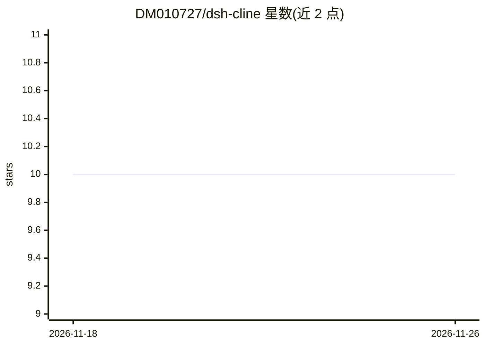

# DM010727/dsh-cline

⭐ 10 · TypeScript · MIT · 推送 2026-10-22 · [GitHub](https://github.com/DM010727/dsh-cline) · [官网](https://www.shengsuanyun.com/?from=CH_L5K542DT) · 组织维护 · 中文 README

**面向 VS Code 开发者的 DeepSeek Harness AI 编码 Agent 插件**

DSH Cline 是基于 DeepSeek Harness 的 VS Code 扩展，使用 DSH 运行时执行 Agent 任务、模型调用、会话与工具执行及 MCP 扩展，无需另装 Cline；通过 VS Code 原生能力连接代码选区、诊断、文件操作与 Diff 预览。核心特色是项目级 RSI：记录用户明确要求、任务复盘提炼经验、按项目召回并评测召回策略，支持版本回滚。公开源码为基础功能（MIT），RSI 处于试验阶段未开源；需 Node.js 22.19+ 或 24+。

## 筛选速览

| 维度 | 判定 | 备注 |
|---|---|---|
| AI 角色 | `ai-native` | 本体是模型或模型工具 |
| 许可风险 | `permissive` | MIT |
| 部署形态 | `library` | 以包/库形式分发 |
| 模型依赖 | locked-api |  |
| 硬件要求 | — | 无带数字的原话,不猜 |
| 安装摩擦 | `low` | 无编译、无系统依赖或容器化 |
| 成熟度 | `idea` | |

## 能力要点

- 基于 DeepSeek Harness 运行 Agent 任务，含审批策略与 shadow Git 检查点
- Cline 式编辑器交互：选区/诊断进入任务，原生 Diff 预览修改
- 项目级 RSI：经验记录、斜杠命令管理、按项目隔离召回与策略验证回滚
- 支持 MCP 接入更多工具，按项目独立配置复盘模型与调用次数

## 适用场景

- 在 VS Code 中用 DeepSeek 模型执行编码 Agent 任务
- 让 Agent 记住并遵循项目的长期工作规范
- 通过检查点与 Diff 审查 Agent 的文件修改

## 场景标签

`编码 Agent` · 领域:编码与开发

## 证据(README 行号)

> L3: **基于 DeepSeek Harness 的 VS Code AI Agent，集成 Cline 式交互与项目级 RSI。**
> L11: DSH Cline 使用 **DeepSeek Harness** 运行 Agent 任务，管理模型、会话和工具执行；通过 **VS Code 原生能力与 Cline 式交互**，连接代码选区、诊断、文件操作和修改预览。
> L13: **项目级 RSI** 将用户明确要求、项目知识和任务复盘接入后续任务：保存经验、按任务召回，再利用真实适用性反馈评测召回策略。它还支持比较不同学习器配置产生的后继策略，通过验证后更新版本，保留来源与回滚能力。产品目标是让 Age

## 星数曲线

2026-11-18 10 → 2026-11-26 10（+0）

---
*卡片 v1 · prompt 1.4 · 生成 2026-11-20 · 置信度 high · 依据 README sha `56b28415038c` · [字段定义](../../DATASET.md)*
