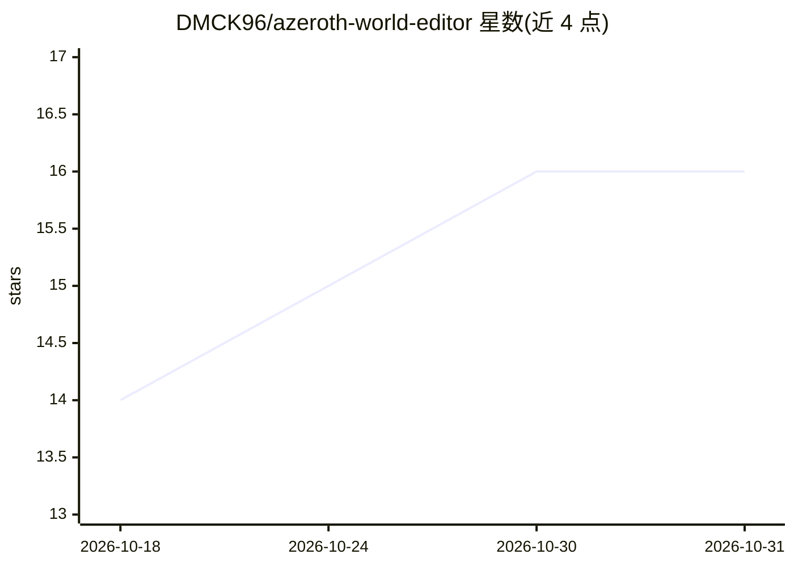

# DMCK96/azeroth-world-editor

⭐ 16 · TypeScript · GPL-3.0 · 推送 2026-10-29 · [GitHub](https://github.com/DMCK96/azeroth-world-editor) · [官网](https://dmck96.github.io/azeroth-world-editor/) · 个人维护

**AzerothCore 服务器的 3D 世界与任务编辑器，支持 MCP AI 助手**

面向 AzerothCore（含 Conquest 分支）私服开发者的桌面应用：从游戏客户端文件渲染 3D 世界，可视化放置 NPC、物体、巡逻路径，编辑任务链、任务脚本、战斗设计与战利品，最终导出为 SQL 补丁或应用到开发数据库（线上库只读）。AI 部分：在设置中开启 MCP / AI 后可连接 Claude Code 等助手代写任务、场景、Boss 战与巡逻，每步 AI 修改独立可撤销且不写世界数据库。需 MySQL 世界数据库，客户端文件夹为推荐项（缺失时仅任务工具可用）。

## 筛选速览

| 维度 | 判定 | 备注 |
|---|---|---|
| AI 角色 | `ai-enhanced` | 去掉 AI 部分产品仍成立 |
| 许可风险 | `viral` | GPL-3.0 |
| 部署形态 | `desktop` | 安装包/桌面程序 |
| 模型依赖 | — | README 未给出锁定关系 |
| 硬件要求 | — | 无带数字的原话,不猜 |
| 安装摩擦 | `low` | 无编译、无系统依赖或容器化 |
| 成熟度 | — | 结构信号不足 |

## 能力要点

- 从客户端文件渲染的 3D 世界中放置 NPC/物体并绘制巡逻路径
- 任务链可视化编辑与拖拽连接，含脚本场景与战斗向导
- 内置 MCP 支持，AI 助手可代写任务/场景/Boss 战，每步可撤销
- 变更审阅后导出 SQL 补丁，线上数据库只读

## 适用场景

- 在 3D 视图中搭建魔兽私服任务链与 NPC 布置
- 让 Claude Code 等 AI 助手代写任务、Boss 战和巡逻
- 无需手工改数据库表即可生成 SQL 补丁发布到服务器

## 场景标签

 · 领域:游戏服务器开发工具

## 证据(README 行号)

> L28: - **Work with an AI assistant.** Turn on MCP / AI in Settings and connect an assistant such as Claude Code. It can 
> L21: - **The world in 3D.** Walk the game world from your client files; place, move and turn NPCs and objects (including

## 星数曲线

2026-10-18 14 → 2026-10-31 16（+2）

---
*卡片 v1 · prompt 1.4 · 生成 2026-10-30 · 置信度 high · 依据 README sha `a60131687d9f` · [字段定义](../../DATASET.md)*
