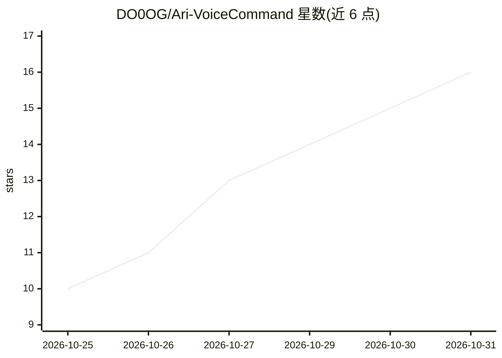

# DO0OG/Ari-VoiceCommand

⭐ 16 · Python · MIT · 推送 2026-10-12 · [GitHub](https://github.com/DO0OG/Ari-VoiceCommand) · [官网](https://ari-voice-command.vercel.app) · 个人维护 · 中文 README

**Windows 开源 AI 语音助手：唤醒词对话并自动操作桌面**

面向 Windows 10/11 桌面用户的语音助手应用：通过唤醒词、快捷键或点击桌面角色发起对话，逐句朗读回答、可随时打断；识别音量、截图、启动应用等常用命令并本地直接执行，复杂任务由 agent 分步规划执行。模型可选本地 Ollama、托管服务或任意 OpenAI 兼容服务器；语音识别支持 Google 或离线 Whisper，合成支持 Edge、本地 CosyVoice3 等多种引擎。具备记忆、插件/SKILL.md/MCP 扩展、Telegram 远程命令（默认关闭）。仅限 Windows 64 位，提供安装包与源码运行两种方式。

## 筛选速览

| 维度 | 判定 | 备注 |
|---|---|---|
| AI 角色 | `ai-native` | 本体是模型或模型工具 |
| 许可风险 | `permissive` | MIT |
| 部署形态 | `desktop` | 安装包/桌面程序 |
| 模型依赖 | local-ok | 支持本地模型 |
| 硬件要求 | `gpu-8g` | |
| 安装摩擦 | `low` | 无编译、无系统依赖或容器化 |
| 成熟度 | — | 结构信号不足 |

## 能力要点

- 唤醒词/快捷键/点击角色三种唤醒方式的语音对话，可随时打断
- 常用命令不经 LLM 本地直执行，复杂任务 agent 分步执行
- Ollama 本地模型 + Whisper + CosyVoice3 + 本地嵌入的全本地处理路径
- 插件、SKILL.md 技能与 MCP 服务器扩展机制

## 适用场景

- 用语音控制电脑音量、截图、启动应用等日常操作
- 在 Windows 上运行全本地化、数据不出机的 AI 助手
- 通过对话让 agent 执行多步骤桌面任务
- 通过 Telegram 远程向 PC 发送指令

## 场景标签

`语音 Agent` `AI 助手` `GUI 自动化` · 领域:效率与自动化

## 证据(README 行号)

> L22: Ari is an **open-source AI voice assistant for Windows**. Call it with a wake word or a hotkey, or click the deskto
> L31: |**Voice conversation**|Start talking with a wake word, a hotkey, or a click on the character. Answers are spoken s

## 星数曲线

2026-10-25 10 → 2026-10-31 16（+6）

---
*卡片 v1 · prompt 1.4 · 生成 2026-10-31 · 置信度 high · 依据 README sha `1a635209f7aa` · [字段定义](../../DATASET.md)*
