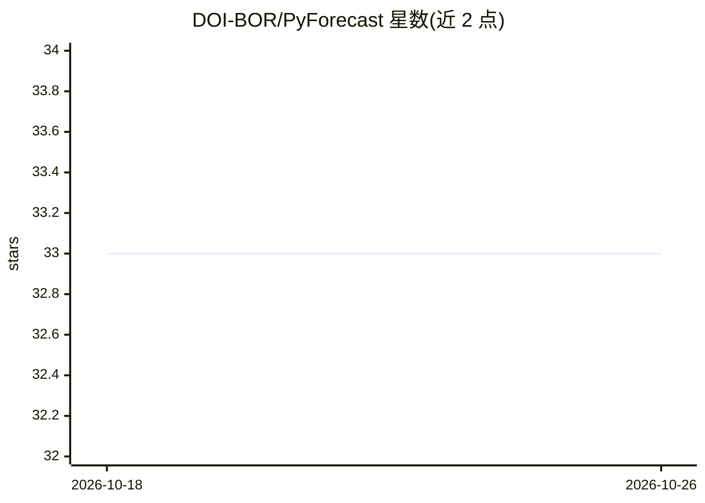

# DOI-BOR/PyForecast

⭐ 33 · Python · NOASSERTION · 推送 2026-10-23 · [GitHub](https://github.com/DOI-BOR/PyForecast) · 组织维护

**水资源管理者的季节性径流统计预测建模工具**

由美国垦务局（Reclamation）MB-ART 与 CPN 区域开发的统计建模桌面工具，面向水资源管理者与水库运行人员，用于构建季节性入流与径流预测模型并生成当水年预报。机制：从 NOAA、RCC-ACIS、NRCS、USGS 等服务采集气象水文数据集，用多元回归、主成分回归、z-score 回归结合序列特征选择与交叉验证生成回归方程，支持多线程多核分析数千个预测因子子集。限制：安装包仅限 Windows，界面内可自动检查更新。

## 筛选速览

| 维度 | 判定 | 备注 |
|---|---|---|
| AI 角色 | `ai-native` | 本体是模型或模型工具 |
| 许可风险 | `none` | NOASSERTION |
| 部署形态 | `desktop` | 安装包/桌面程序 |
| 模型依赖 | — | README 未给出锁定关系 |
| 硬件要求 | — | 无带数字的原话,不猜 |
| 安装摩擦 | `low` | 无编译、无系统依赖或容器化 |
| 成熟度 | — | 结构信号不足 |

## 能力要点

- 从 NOAA/RCC-ACIS/NRCS/Reclamation/USGS 网络服务采集数据并本地存储
- 多元回归、主成分回归、z-score 回归结合序列特征选择与交叉验证
- 地图浏览添加 SNOTEL 站、水库、流量站、PRISM 网格与气候指数数据集
- 支持两列 CSV 平面文件数据源与 Excel 编辑数据

## 适用场景

- 水库运行人员制作季节性入流与径流预报
- 水文分析中筛选统计显著的预测因子回归方程
- 基于已建模型生成当前水年的预报

## 场景标签

 · 领域:水文/水资源

## 证据(README 行号)

> L24: PyForecast is a statistical modeling tool useful in predicting seasonal inflows and
> L26: to thousands of predictor subsets, and returns well-performing statistical regressions

## 星数曲线

2026-10-18 33 → 2026-10-26 33（+0）

---
*卡片 v1 · prompt 1.4 · 生成 2026-10-25 · 置信度 high · 依据 README sha `48e57301b1f5` · [字段定义](../../DATASET.md)*
