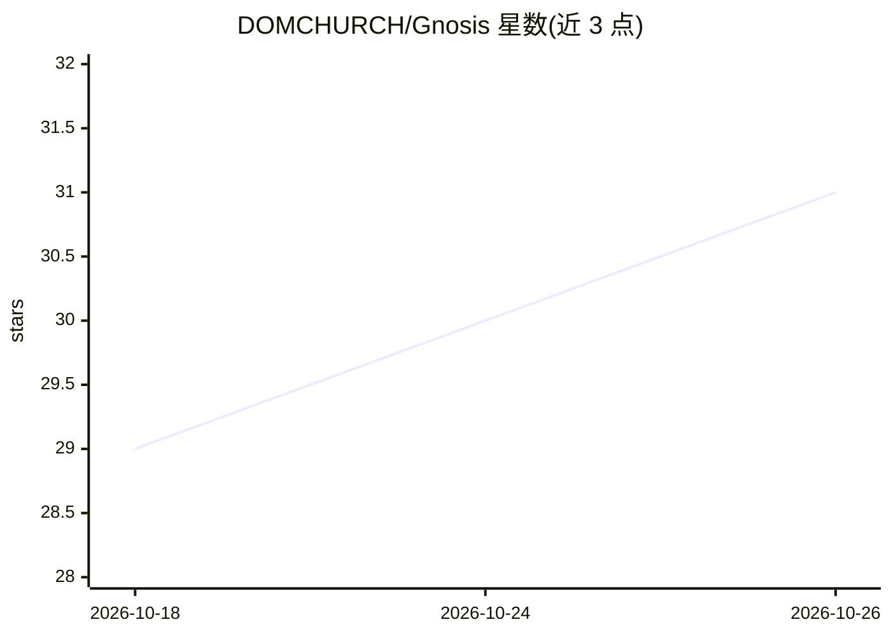

# DOMCHURCH/Gnosis

⭐ 31 · TypeScript · MIT · 推送 2026-09-06 · [GitHub](https://github.com/DOMCHURCH/Gnosis) · 个人维护

**可任意切换模型的终端编程 agent，带 3D 办公室浏览器界面**

面向开发者的终端编码代理：通过 OpenRouter 接入任意模型，可在会话中用 /model 切换模型并保留全部对话历史。提供 Windows 桌面应用（.exe 安装包）、TUI 与 Web UI；Web UI 以 Three.js 3D 办公楼层实时展示各 agent 工作状态，另含 Web 终端、文件浏览器、看板视图与 QR 码手机访问。内置 MCP 客户端（Context7/Playwright/Chrome DevTools）、Obsidian 库记忆、逐轮 diff 评审与提示缓存。仅支持 OpenRouter，需要一个 API key；语音唤醒/朗读为可选组件，需另装 Python 与 Node.js。

## 筛选速览

| 维度 | 判定 | 备注 |
|---|---|---|
| AI 角色 | `ai-native` | 本体是模型或模型工具 |
| 许可风险 | `permissive` | MIT |
| 部署形态 | `desktop` | 安装包/桌面程序 |
| 模型依赖 | locked-api |  |
| 硬件要求 | — | 无带数字的原话,不猜 |
| 安装摩擦 | `low` | 无编译、无系统依赖或容器化 |
| 成熟度 | — | 结构信号不足 |

## 能力要点

- 会话中途切换模型且保留完整历史（/model）
- Three.js 3D 办公楼层实时可视化 agent 工作状态
- 内置 MCP 客户端，捆绑 Context7/Playwright/Chrome DevTools
- 子 agent 隔离上下文预算与逐项成本核算；Obsidian 库记忆自动归档

## 适用场景

- 按任务性质在会话中切换不同价位的模型做编码工作
- 通过浏览器或手机远程查看和驱动多个 agent 并行工作
- 让 agent 读写代码并自动将值得保留的产出归档进 Obsidian

## 场景标签

`编码 Agent` · 领域:编码与开发

## 证据(README 行号)

> L14: Gnosis is a terminal coding agent that runs on any model, switches models
> L160: - **Any model via OpenRouter, switched at runtime** — `/model` mid-session, no

## 星数曲线

2026-10-18 29 → 2026-10-26 31（+2）

---
*卡片 v1 · prompt 1.4 · 生成 2026-10-26 · 置信度 high · 依据 README sha `91ec33a5f070` · [字段定义](../../DATASET.md)*
