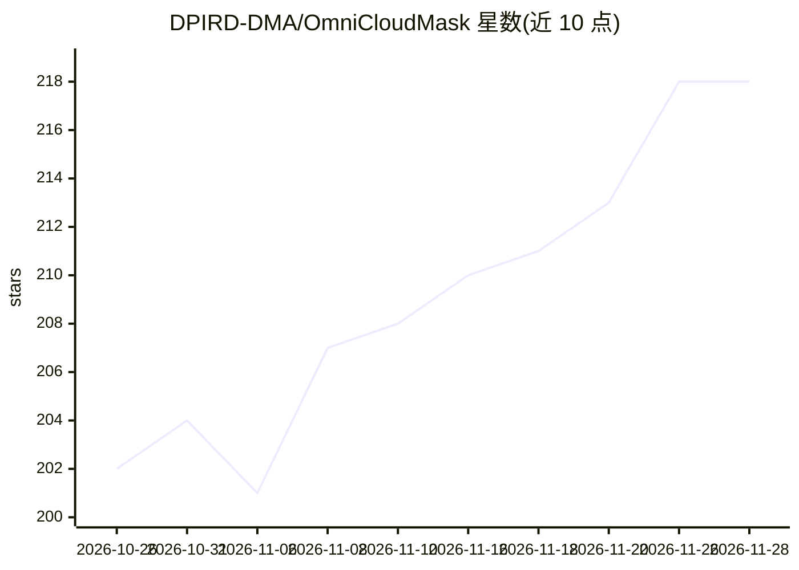

# DPIRD-DMA/OmniCloudMask

⭐ 218 · Python · MIT · 推送 2026-11-19 · [GitHub](https://github.com/DPIRD-DMA/OmniCloudMask) · 组织维护

**对遥感影像做云与云影分割的 Python 库**

基于 PyTorch 深度学习的卫星影像云与云影分割库，输入只需含红、绿、NIR 波段、分辨率 10-50 m（新模型版本可至 5 m）的影像，输出分割掩膜。已在 Sentinel-2、Landsat 8、PlanetScope 和 Maxar 影像上验证。提供 predict_from_array、predict_from_batch、predict_from_load_func 等 Python API，可通过 pip/uv/conda/源码安装，附带多平台示例 Notebook 与 Colab 入口。

## 筛选速览

| 维度 | 判定 | 备注 |
|---|---|---|
| AI 角色 | `ai-native` | 本体是模型或模型工具 |
| 许可风险 | `permissive` | MIT |
| 部署形态 | `library` | 以包/库形式分发 |
| 模型依赖 | — | README 未给出锁定关系 |
| 硬件要求 | — | 无带数字的原话,不猜 |
| 安装摩擦 | `low` | 无编译、无系统依赖或容器化 |
| 成熟度 | — | 结构信号不足 |

## 能力要点

- 仅需红、绿、NIR 三波段即可推理，传感器无关
- 支持数组、批处理与直接加载 Sentinel-2 场景三种预测接口
- 提供 Sentinel-2、PlanetScope、Maxar、HLS 等示例 Notebook
- 提供 Colab 在线运行入口

## 适用场景

- 批量处理 Sentinel-2 场景生成云与云影掩膜
- 对 PlanetScope、Maxar 等高分辨率影像做云检测
- 在图像切片数据集上按批次推理分割结果

## 场景标签

`目标检测` · 领域:感知与多模态

## 证据(README 行号)

> L9: State-of-the-art cloud and cloud shadow segmentation for high to moderate resolution satellite imagery.
> L11: Works with any imagery containing Red, Green, and NIR bands at 10-50 m resolution (and down to 5 m with recent mode

## 星数曲线

2026-10-26 202 → 2026-11-28 218（+16）

---
*卡片 v1 · prompt 1.4 · 生成 2026-11-25 · 置信度 high · 依据 README sha `996a1fb7e45e` · [字段定义](../../DATASET.md)*
