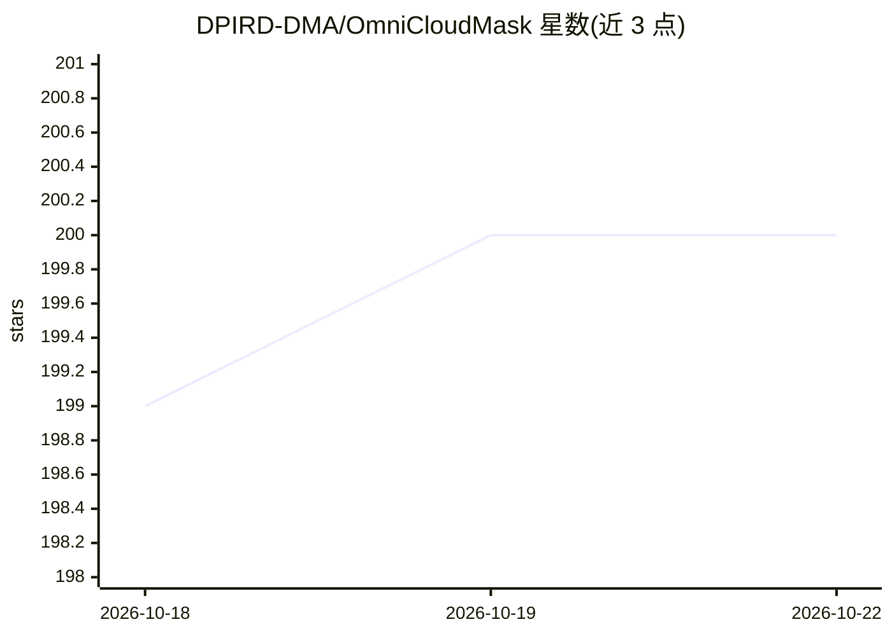

# DPIRD-DMA/OmniCloudMask

⭐ 200 · Python · MIT · 推送 2026-10-19 · [GitHub](https://github.com/DPIRD-DMA/OmniCloudMask) · 组织维护

**卫星影像云与云影分割的 Python 库（深度学习）**

面向遥感影像的云与云影分割库：基于传感器无关的深度学习模型，对含红、绿、近红外波段、10-50 米分辨率（新版可至 5 米）的影像生成分割掩膜，已在 Sentinel-2、Landsat 8、PlanetScope 与 Maxar 影像上验证。提供 pip 安装，API 覆盖数组预测、load 函数预测与批量 chips 推理（如 predict_from_batch 支持 (N,3,512,512) 输入按 batch 处理），附多个卫星数据示例笔记本与 Colab 入口。MIT 许可。

## 筛选速览

| 维度 | 判定 | 备注 |
|---|---|---|
| AI 角色 | `ai-native` | 本体是模型或模型工具 |
| 许可风险 | `permissive` | MIT |
| 部署形态 | `library` | 以包/库形式分发 |
| 模型依赖 | — | README 未给出锁定关系 |
| 硬件要求 | — | 无带数字的原话,不猜 |
| 安装摩擦 | `low` | 无编译、无系统依赖或容器化 |
| 成熟度 | — | 结构信号不足 |

## 能力要点

- 传感器无关的深度学习云/云影分割，仅需红绿近红外三波段
- 10-50 米分辨率影像适用（新版模型可至 5 米）
- predict_from_array / predict_from_load_func / predict_from_batch 三种推理接口
- Sentinel-2、Landsat 8、PlanetScope、Maxar 等多种卫星数据的示例笔记本

## 适用场景

- 对 Sentinel-2/Landsat 等卫星场景批量生成云与云影掩膜
- 遥感分析流程中预处理去云
- 对同尺寸影像 chips 数据集做批量云检测

## 场景标签

`目标检测` · 领域:感知与多模态

## 证据(README 行号)

> L9: State-of-the-art cloud and cloud shadow segmentation for high to moderate resolution satellite imagery.
> L11: Works with any imagery containing Red, Green, and NIR bands at 10-50 m resolution (and down to 5 m with recent mode
> L71: Sensor agnostic Deep Learning with OmniCloudMask

## 星数曲线

2026-10-18 199 → 2026-10-22 200（+1）

---
*卡片 v1 · prompt 1.4 · 生成 2026-10-22 · 置信度 high · 依据 README sha `55697b30792d` · [字段定义](../../DATASET.md)*
